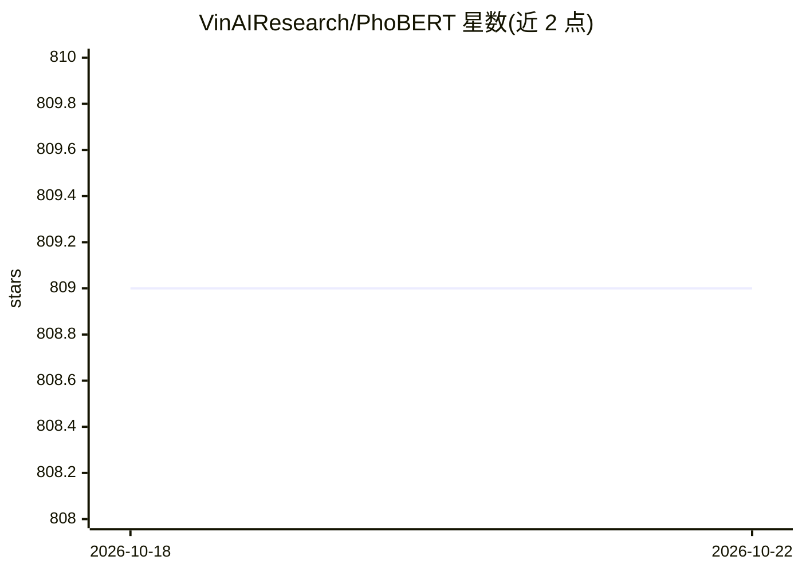

# VinAIResearch/PhoBERT

⭐ 809 · MIT · 推送 2026-08-04 · [GitHub](https://github.com/VinAIResearch/PhoBERT) · 组织维护

**越南语预训练语言模型（RoBERTa 架构），供下游 NLP 任务使用**

VinAI Research 发布的首个公开大规模越南语单语预训练语言模型，含 base（135M）与 large（370M）两个版本及 phobert-base-v2，基于 RoBERTa 优化 BERT 预训练流程，最大长度 256。可在词性标注、依存句法分析、命名实体识别、自然语言推理等下游任务中使用。通过 HuggingFace transformers（含专用分词器安装分支）或 fairseq 加载；输入原始文本需先用 VDRSegmenter（VnCoreNLP）分词。各版本许可证不一（MIT 或 AGPLv3），README 另推荐后继模型 BamiBERT。

## 筛选速览

| 维度 | 判定 | 备注 |
|---|---|---|
| AI 角色 | `ai-native` | 本体是模型或模型工具 |
| 许可风险 | `permissive` | MIT |
| 部署形态 | `library` | 以包/库形式分发 |
| 模型依赖 | — | README 未给出锁定关系 |
| 硬件要求 | — | 无带数字的原话,不猜 |
| 安装摩擦 | `low` | 无编译、无系统依赖或容器化 |
| 成熟度 | — | 结构信号不足 |

## 能力要点

- base/large 两版本，phobert-base-v2 基于 20GB+120GB 语料预训练
- 支持 transformers 与 fairseq 两种使用方式
- 覆盖 POS/依存句法/NER/NLI 四类下游任务
- 原始文本需先经 VnCoreNLP RDRSegmenter 分词预处理

## 适用场景

- 为越南语 NLP 任务提供预训练编码器/词向量
- 微调做越南语命名实体识别或自然语言推理
- 作为越南语信息抽取管线的嵌入层

## 场景标签

 · 领域:NLP/预训练语言模型

## 证据(README 行号)

> L5: Pre-trained PhoBERT models are the state-of-the-art language models for Vietnamese (Pho, i.e. "Phở", is a popular fo
> L7:  - Two PhoBERT versions of "base" and "large" are the first public large-scale monolingual language models pre-train
> L42: `vinai/phobert-base-v2` | 135M | base | 256 | 20GB of Wikipedia and News texts + 120GB of texts from OSCAR-2301 | G

## 星数曲线

2026-10-18 809 → 2026-10-22 809（+0）

---
*卡片 v1 · prompt 1.4 · 生成 2026-10-21 · 置信度 high · 依据 README sha `7fa10d69e7d9` · [字段定义](../../DATASET.md)*
