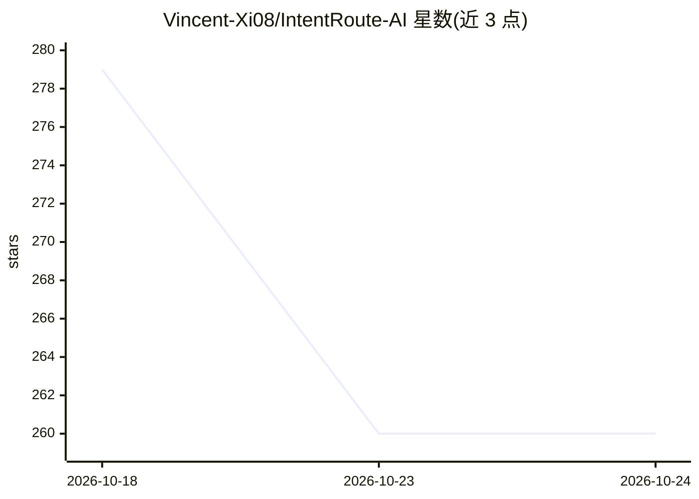

# Vincent-Xi08/IntentRoute-AI

⭐ 260 · C# · MIT · 推送 2026-10-14 · [GitHub](https://github.com/Vincent-Xi08/IntentRoute-AI) · 个人维护 · 中文 README

**Windows 分应用代理路由工具：AI 起草 sing-box TUN 路由规则**

开源 Windows WPF 控制面，将自然语言网络意图转为经本地校验的路由规则草稿：可选 OpenAI Responses API 或本地 Ollama 生成结构化草稿，草稿经确定性校验（字段/域名/CIDR/端口/冲突等）后以禁用状态加入，启用需用户单独操作并执行 sing-box check。数据面由外部 sing-box v1.13+ TUN 进程承担，应用自身不抓包。另含本地 Policy Intelligence（规则冲突/遮蔽分析）与静态 Route Decision Simulator。当前为 v0.31.0 preview，未声明广泛生产使用。

## 筛选速览

| 维度 | 判定 | 备注 |
|---|---|---|
| AI 角色 | `ai-enhanced` | 去掉 AI 部分产品仍成立 |
| 许可风险 | `permissive` | MIT |
| 部署形态 | `desktop` | 安装包/桌面程序 |
| 模型依赖 | local-ok | 支持本地模型 |
| 硬件要求 | — | 无带数字的原话,不猜 |
| 安装摩擦 | `medium` | 含编译或系统依赖之一 |
| 成熟度 | `idea` | |

## 能力要点

- 自然语言→结构化规则草稿，AI 输出按不可信输入本地校验并以禁用状态加入
- 生成 sing-box v1.13+ TUN 配置并监督外部进程，含原子候选配置与回滚
- 本地 Policy Intelligence 分析重复/冲突/遮蔽/宽范围规则，AI 解释仅限去标识化聚合摘要
- 静态 Route Decision Simulator 输出 proven-match/fallback/indeterminate 三值结果

## 适用场景

- 为不提供代理设置的 Windows 应用按进程/域名/IP 配置分流
- 用自然语言描述意图生成可审查的路由规则草稿
- 分析现有规则集的冲突、遮蔽与宽范围问题

## 场景标签

`代码生成` · 领域:编码与开发

## 证据(README 行号)

> L9: IntentRoute AI is an open-source Windows control plane that turns plain-language network intent into locally validat
> L17: Many Windows applications do not expose useful proxy controls, while hand-authoring process/domain/IP routing rules
> L24: The application does not capture packets itself. It generates a validated sing-box v1.13+ TUN configuration, starts

## 星数曲线

2026-10-18 279 → 2026-10-24 260（-19）

---
*卡片 v1 · prompt 1.4 · 生成 2026-10-22 · 置信度 high · 依据 README sha `631991bd0692` · [字段定义](../../DATASET.md)*
