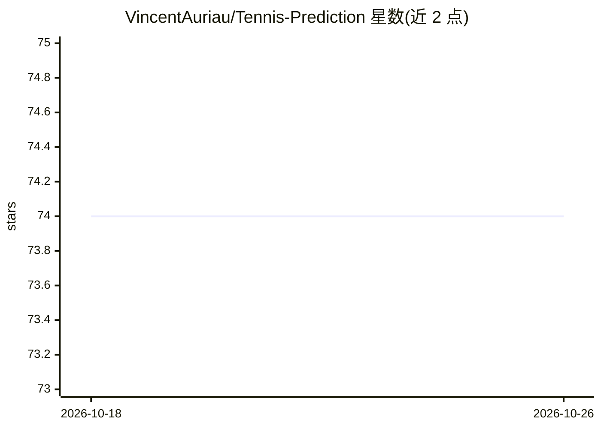

# VincentAuriau/Tennis-Prediction

⭐ 74 · Python · MIT · 推送 2026-06-15 · [GitHub](https://github.com/VincentAuriau/Tennis-Prediction) · 个人维护

**用机器学习预测网球比赛胜负的项目**

基于两名球员历史数据与机器学习模型预测网球比赛胜负的项目。数据来自 Jeff Sackmann 的 tennis_atp 仓库（以 git 子模块引入），提供数据加载器读取赛前球员统计（排名、发球、各场地胜率等）与比赛结果。建模部分提供 scikit-learn 风格的训练/测试评估函数，可比较不同模型与超参数并将结果存入 results.csv；另含 PCA 比赛历史编码器用于二维可视化。README 未声明许可证内容与模型性能承诺，面向数据分析与机器学习使用者。

## 筛选速览

| 维度 | 判定 | 备注 |
|---|---|---|
| AI 角色 | `ai-native` | 本体是模型或模型工具 |
| 许可风险 | `permissive` | MIT |
| 部署形态 | `None` |  |
| 模型依赖 | — | README 未给出锁定关系 |
| 硬件要求 | — | 无带数字的原话,不猜 |
| 安装摩擦 | `low` | 无编译、无系统依赖或容器化 |
| 成熟度 | — | 结构信号不足 |

## 能力要点

- 提供赛前球员统计与比赛结果的数据加载器
- 通用 train/test 评估函数，兼容 scikit-learn 风格签名
- 模型与超参数结果对比输出到 results.csv
- PCAMatchEncoder 对球员比赛历史做降维编码

## 适用场景

- 我想训练并评估预测 ATP 网球比赛胜负的机器学习模型
- 我需要加载并分析球员历史战绩与赛前统计特征
- 我想比较不同模型和超参数在网球胜负预测上的表现

## 场景标签

 · 领域:体育数据/机器学习

## 证据(README 行号)

> L3: The goal of this project is to predict the outcome of a tennis match using the data of both players and ML models.\
> L112: ### Machine-Learning modelling

## 星数曲线

2026-10-18 74 → 2026-10-26 74（+0）

---
*卡片 v1 · prompt 1.4 · 生成 2026-10-24 · 置信度 high · 依据 README sha `2c2c223dc3a2` · [字段定义](../../DATASET.md)*
