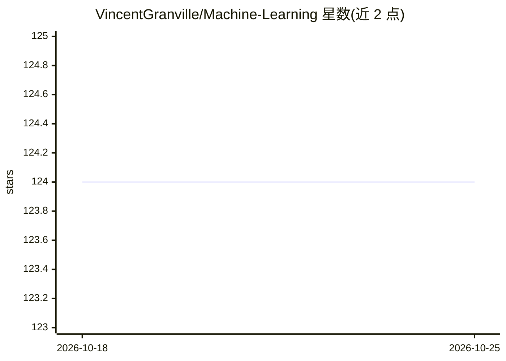

# VincentGranville/Machine-Learning

⭐ 124 · Python · 推送 2026-09-23 · [GitHub](https://github.com/VincentGranville/Machine-Learning) · [官网](https://mltechniques.com/product/intuitive-machine-learning/) · 个人维护

**《Intuitive Machine Learning》书籍配套的 Python 代码与电子表格**

作者 Vincent Granville 为其书籍《Intuitive Machine Learning》（部分内容亦见于《Synthetic Data and Generative AI》）整理的配套材料仓库。内容为 Python 脚本与 Excel 电子表格，覆盖隐决策树集成方法、布朗运动路径、可解释模糊回归、曲线拟合、形状分类等主题，每个文件对应一篇可公开访问的文章。以仓库形式提供，未给出打包安装途径，需自行下载文件并配合文章阅读使用。

## 筛选速览

| 维度 | 判定 | 备注 |
|---|---|---|
| AI 角色 | `ai-knowledge` | 知识聚合/清单类 |
| 许可风险 | `none` | — |
| 部署形态 | `None` |  |
| 模型依赖 | — | README 未给出锁定关系 |
| 硬件要求 | — | 无带数字的原话,不猜 |
| 安装摩擦 | `low` | 无编译、无系统依赖或容器化 |
| 成熟度 | — | 结构信号不足 |

## 能力要点

- Python 脚本含隐决策树集成、模糊回归、曲线拟合等实现
- Excel 电子表格覆盖回归、形状分类、线性代数示例
- 每个文件对应一篇配套文章，可公开访问

## 适用场景

- 配合书籍与文章学习可解释机器学习方法
- 获取隐决策树、模糊回归等算法的参考实现
- 在 Excel 中探索机器学习示例数据与模型

## 场景标签

`教程课程` · 领域:学习与行业

## 证据(README 行号)

> L1: This repository contains the material related to my book Intuitive Machine Learning , available here. The table of c

## 星数曲线

2026-10-18 124 → 2026-10-25 124（+0）

---
*卡片 v1 · prompt 1.4 · 生成 2026-10-23 · 置信度 high · 依据 README sha `722133d1085b` · [字段定义](../../DATASET.md)*
