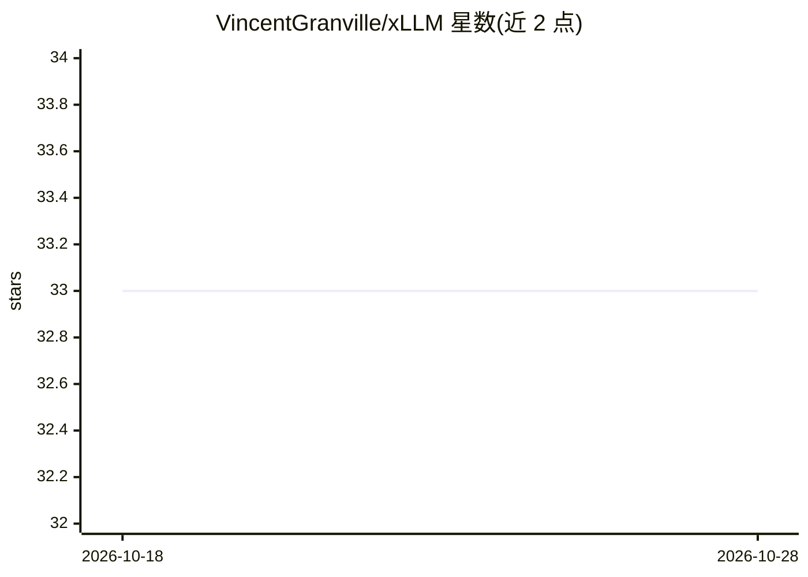

# VincentGranville/xLLM

⭐ 33 · Python · 推送 2026-04-18 · [GitHub](https://github.com/VincentGranville/xLLM) · [官网](https://bondingai.io/) · 组织维护

**从零构建的可解释企业级 LLM 框架，含专用 DNN 与 AI agents**

BondingAI 开发的 xLLM 2.0，以纯 Python 从零实现、不依赖 PyTorch/TensorFlow/Keras。功能包括：PDF 解析与 JSON 化、保序 multitoken 与嵌套哈希内存数据库、相关性/可信度评分、实时调参 UI、变长嵌入；自研可解释 DNN 及基于万维精确插值的替代方案（验证集 next-token 正确率 96%），另有异常检测、无 GAN 数据合成、ECG 模式识别三个 agent。注意：README 为能力描述清单，未给出安装运行命令，代码模块分布于本仓库及旧版 xLLM 仓库。

## 筛选速览

| 维度 | 判定 | 备注 |
|---|---|---|
| AI 角色 | `ai-native` | 本体是模型或模型工具 |
| 许可风险 | `none` | — |
| 部署形态 | `None` |  |
| 模型依赖 | — | README 未给出锁定关系 |
| 硬件要求 | — | 无带数字的原话,不猜 |
| 安装摩擦 | `low` | 无编译、无系统依赖或容器化 |
| 成熟度 | — | 结构信号不足 |

## 能力要点

- 不依赖 PyTorch/TensorFlow/Keras 的自研 DNN 及精确插值替代方案
- 嵌套哈希内存数据库替代向量/图数据库
- 响应条目级相关性评分与来源可信度评分
- 异常检测、数据合成、ECG 三个专用 agent

## 适用场景

- 企业内部数据问答与可审计检索（含 PDF 语料）
- 需要解释性与来源可信度评分的搜索场景
- 对自研 DNN 做水印保护与参数蒸馏实验

## 场景标签

`RAG` `文档解析` `Agent 框架` · 领域:Agent 开发

## 证据(README 行号)

> L31: This new material is not in the old repository. It features our proprietary DNN based on explainable AI, as well as
> L33:  xLLM's original Deep Neural Network built from scratch, different from others, offering full control over all the 
> L40:  Anomality Detection Agent with applications in cybersecurity, used in fraud litigation.

## 星数曲线

2026-10-18 33 → 2026-10-28 33（+0）

---
*卡片 v1 · prompt 1.4 · 生成 2026-10-25 · 置信度 mid · 依据 README sha `ad31701a61e0` · [字段定义](../../DATASET.md)*
