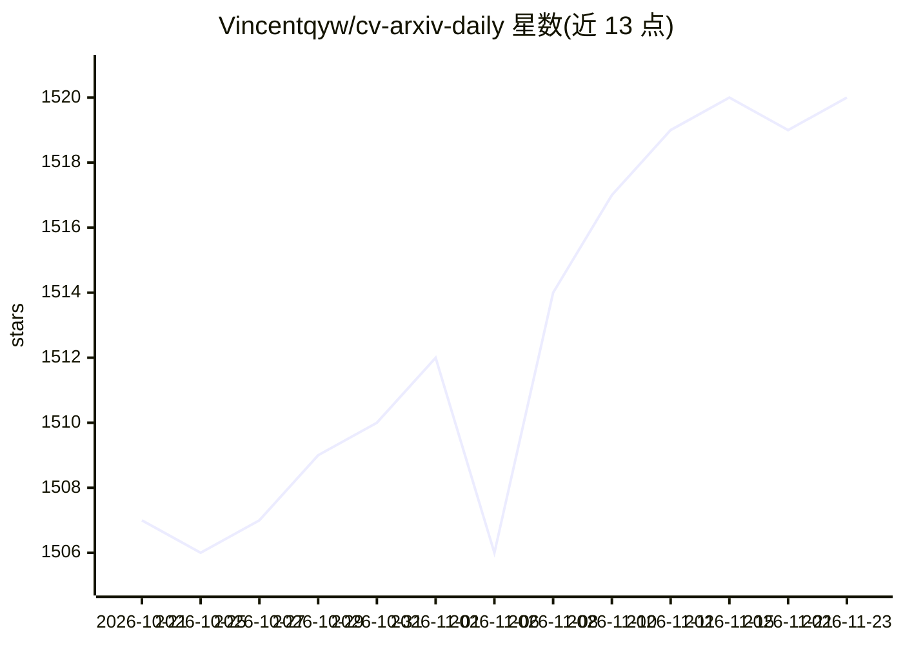

# Vincentqyw/cv-arxiv-daily

⭐ 1,520 · Python · Apache-2.0 · 推送 2026-11-21 · [GitHub](https://github.com/Vincentqyw/cv-arxiv-daily) · [官网](https://papers.vincentqin.tech) · 个人维护

**为 CV/机器人研究者每日自动更新的 arXiv 论文清单**

通过 GitHub Actions 每日自动抓取并更新计算机视觉相关 arXiv 论文的清单仓库。条目按 SLAM、SFM、Visual Localization、Keypoint Detection、Image Matching、NeRF、Gaussian Splatting、3D Reconstruction、World Model、VLA/VLN 等 10 个主题分类组织，每条记录发布日期、标题、作者、PDF 链接与代码链接；另按年份归档全部论文，每主题每年一个 markdown 文件。面向跟踪 CV 与机器人前沿研究的科研人员，README 主体为论文目录表格。

## 筛选速览

| 维度 | 判定 | 备注 |
|---|---|---|
| AI 角色 | `ai-knowledge` | 知识聚合/清单类 |
| 许可风险 | `permissive` | Apache-2.0 |
| 部署形态 | `None` |  |
| 模型依赖 | — | README 未给出锁定关系 |
| 硬件要求 | — | 无带数字的原话,不猜 |
| 安装摩擦 | `low` | 无编译、无系统依赖或容器化 |
| 成熟度 | — | 结构信号不足 |

## 能力要点

- GitHub Actions 每日自动更新论文列表
- 10 个主题分类（SLAM/SFM/NeRF/3D 重建等）加按年归档
- 每条论文含发布日期、作者、PDF 与代码链接

## 适用场景

- 每日快速浏览 SLAM、3D 重建等方向的新论文
- 按年份回溯某个主题的历史论文列表
- 查找某篇论文是否开源了代码

## 场景标签

`科研工具` · 领域:学习与行业

## 证据(README 行号)

> L4:  Table of Contents
> L22: |Year|SLAM|SFM|Visual Localization|Keypoint Detection|Image Matching|NeRF|Gaussian Splatting|3D Reconstruction|Worl
> L33: |Publish Date|Title|Authors|PDF|Code|

## 星数曲线

2026-10-21 1,507 → 2026-11-23 1,520（+13）

---
*卡片 v1 · prompt 1.4 · 生成 2026-11-23 · 置信度 high · 依据 README sha `013c9d17b25e` · [字段定义](../../DATASET.md)*
