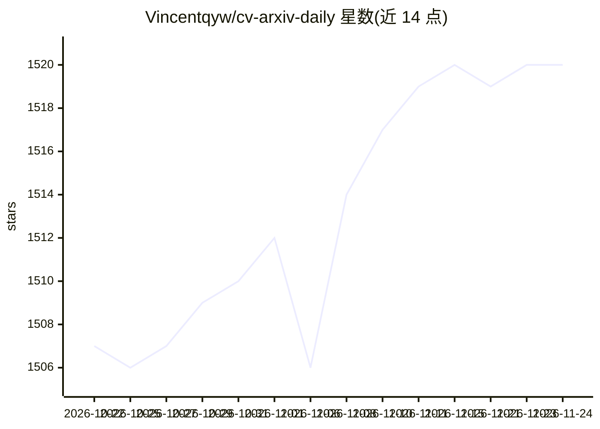

# Vincentqyw/cv-arxiv-daily

⭐ 1,520 · Python · Apache-2.0 · 推送 2026-11-23 · [GitHub](https://github.com/Vincentqyw/cv-arxiv-daily) · [官网](https://papers.vincentqin.tech) · 个人维护

**计算机视觉领域 arXiv 论文每日自动追踪清单**

通过 GitHub Actions 每日自动更新的计算机视觉论文追踪仓库，按 SLAM、SFM、视觉定位、关键点检测、图像匹配、NeRF、Gaussian Splatting、3D 重建、World Model、VLA/VLN 等类别组织条目；每条论文列出发布日期、标题、作者、PDF 链接与代码链接。另提供 Archive 页，按年份与关键词汇总历年论文的 markdown 文件及各分类条目数量统计。

## 筛选速览

| 维度 | 判定 | 备注 |
|---|---|---|
| AI 角色 | `ai-knowledge` | 知识聚合/清单类 |
| 许可风险 | `permissive` | Apache-2.0 |
| 部署形态 | `None` |  |
| 模型依赖 | — | README 未给出锁定关系 |
| 硬件要求 | — | 无带数字的原话,不猜 |
| 安装摩擦 | `low` | 无编译、无系统依赖或容器化 |
| 成熟度 | — | 结构信号不足 |

## 能力要点

- GitHub Actions 每日自动更新论文列表
- 10 个 CV 子领域分类组织（SLAM/NeRF/图像匹配等）
- Archive 页按年份与关键词汇总历年论文
- 每条论文附 PDF 与代码链接

## 适用场景

- 每天浏览 SLAM、NeRF 等 CV 子领域的最新 arXiv 论文
- 查找某篇论文的开源代码链接
- 按年份回顾某研究方向的论文积累

## 场景标签

`科研工具` `精选清单` · 领域:学习与行业

## 证据(README 行号)

> L1: ## Updated on 2026.11.23
> L22: |Year|SLAM|SFM|Visual Localization|Keypoint Detection|Image Matching|NeRF|Gaussian Splatting|3D Reconstruction|Worl

## 星数曲线

2026-10-22 1,507 → 2026-11-24 1,520（+13）

---
*卡片 v1 · prompt 1.4 · 生成 2026-11-24 · 置信度 high · 依据 README sha `4f7e0beba49d` · [字段定义](../../DATASET.md)*
