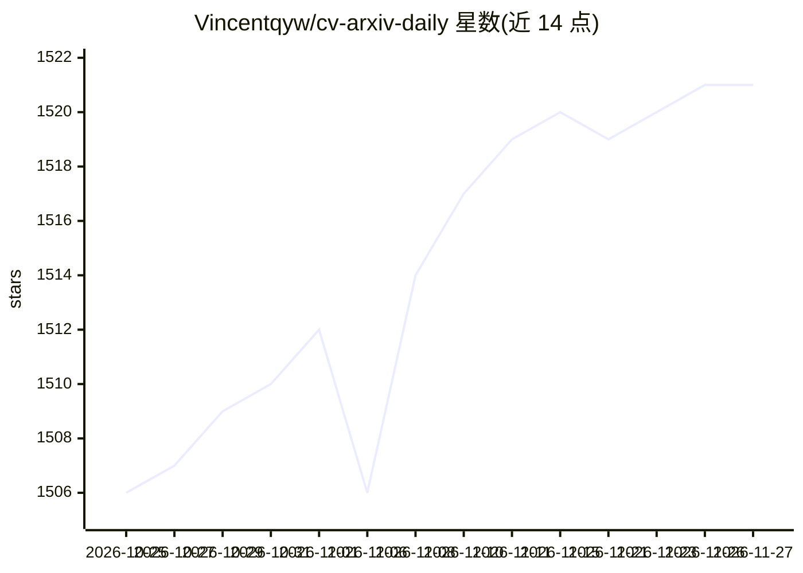

# Vincentqyw/cv-arxiv-daily

⭐ 1,521 · Python · Apache-2.0 · 推送 2026-11-26 · [GitHub](https://github.com/Vincentqyw/cv-arxiv-daily) · [官网](https://papers.vincentqin.tech) · 个人维护

**每日自动更新 CV 论文清单：按 10 个方向归档 arXiv 精选**

使用 GitHub Actions 每日自动抓取计算机视觉相关 arXiv 论文，按 SLAM、SFM、Visual Localization、Keypoint Detection、Image Matching、NeRF、Gaussian Splatting、3D Reconstruction、World Model、VLA/VLN 十个类别组织，README 展示最新论文列表（标题、作者、PDF、Code 链接），并按年份归档为每年每关键词一个 markdown 文件的 Archive。面向需要跟踪 CV 研究动态的科研与工程人员。README 主体为论文目录表，收录条目覆盖 2021 至 2026 年。

## 筛选速览

| 维度 | 判定 | 备注 |
|---|---|---|
| AI 角色 | `ai-knowledge` | 知识聚合/清单类 |
| 许可风险 | `permissive` | Apache-2.0 |
| 部署形态 | `None` |  |
| 模型依赖 | — | README 未给出锁定关系 |
| 硬件要求 | — | 无带数字的原话,不猜 |
| 安装摩擦 | `low` | 无编译、无系统依赖或容器化 |
| 成熟度 | — | 结构信号不足 |

## 能力要点

- GitHub Actions 每日自动更新论文列表
- 10 个 CV 研究方向分类组织（SLAM/NeRF/3D 重建等）
- 按年份归档，每年每关键词一个 markdown 文件
- 条目附 PDF 与代码链接

## 适用场景

- 每天快速浏览 SLAM、NeRF 等 CV 方向新论文
- 按年份检索某研究方向的历史论文列表
- 查看论文是否有开源代码实现

## 场景标签

`科研工具` `精选清单` · 领域:学习与行业

## 证据(README 行号)

> L1: ## Updated on 2026.11.26
> L22: |Year|SLAM|SFM|Visual Localization|Keypoint Detection|Image Matching|NeRF|Gaussian Splatting|3D Reconstruction|Worl
> L31: ## SLAM

## 星数曲线

2026-10-25 1,506 → 2026-11-27 1,521（+15）

---
*卡片 v1 · prompt 1.4 · 生成 2026-11-27 · 置信度 high · 依据 README sha `44c6c35b6f74` · [字段定义](../../DATASET.md)*
