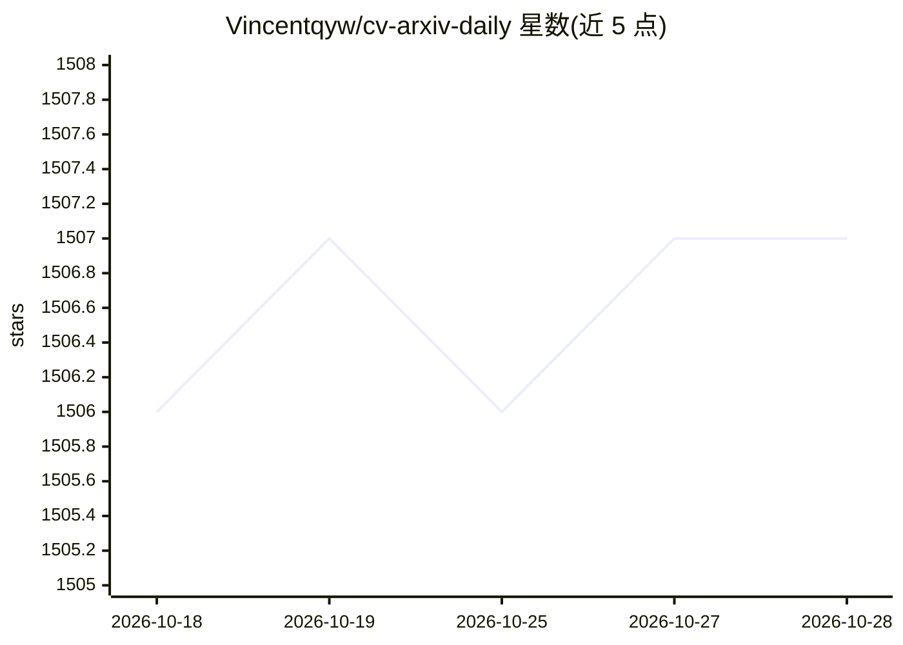

# Vincentqyw/cv-arxiv-daily

⭐ 1,509 · Python · Apache-2.0 · 推送 2026-10-26 · [GitHub](https://github.com/Vincentqyw/cv-arxiv-daily) · [官网](https://papers.vincentqin.tech) · 个人维护

**每日自动更新的计算机视觉 arXiv 论文清单**

利用 GitHub Actions 自动抓取并每日更新计算机视觉方向的 arXiv 论文列表，按 SLAM、SFM、视觉定位、关键点检测、图像匹配、NeRF、高斯泼溅、3D 重建、世界模型、VLA/VLN 等关键词分类组织。每条论文记录发布日期、标题、作者、PDF 编号与代码链接，并按年份和关键词生成归档统计表。面向 CV 与机器人方向的研究者追踪新论文使用。

## 筛选速览

| 维度 | 判定 | 备注 |
|---|---|---|
| AI 角色 | `ai-knowledge` | 知识聚合/清单类 |
| 许可风险 | `permissive` | Apache-2.0 |
| 部署形态 | `None` |  |
| 模型依赖 | — | README 未给出锁定关系 |
| 硬件要求 | — | 无带数字的原话,不猜 |
| 安装摩擦 | `low` | 无编译、无系统依赖或容器化 |
| 成熟度 | — | 结构信号不足 |

## 能力要点

- GitHub Actions 每日自动更新论文列表
- 覆盖 SLAM/NeRF/3D 重建等 10 个 CV 子方向
- 按年份与关键词生成论文数量归档表
- 条目含 arXiv PDF 编号与代码链接

## 适用场景

- 每日追踪 SLAM 与 3D 重建方向的新论文
- 按关键词分类浏览历年 CV 论文
- 通过代码链接找到论文开源实现

## 场景标签

`科研工具` `精选清单` · 领域:学习与行业

## 证据(README 行号)

> L1: ## Updated on 2026.10.19
> L7:  SLAM
> L24: |2026|181|96|175|39|51|114|10|10|9|10|

## 星数曲线

2026-10-18 1,506 → 2026-10-28 1,507（+1）

---
*卡片 v1 · prompt 1.4 · 生成 2026-10-21 · 置信度 high · 依据 README sha `0016a8e64867` · [字段定义](../../DATASET.md)*
