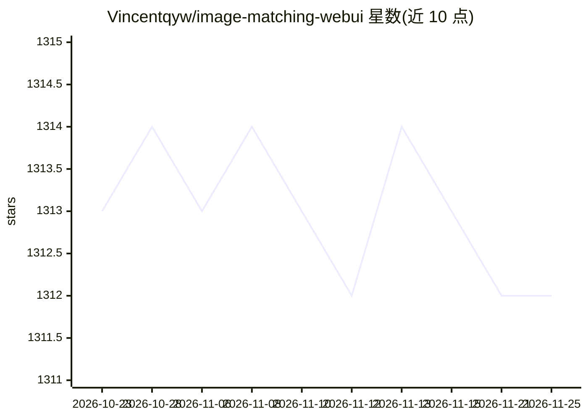

# Vincentqyw/image-matching-webui

⭐ 1,312 · Python · Apache-2.0 · 推送 2026-11-23 · [GitHub](https://github.com/Vincentqyw/image-matching-webui) · [官网](https://huggingface.co/spaces/Realcat/image-matching-webui) · 个人维护

**给研究者的多算法图像关键点匹配 WebUI 工具**

基于 gradio 的图形界面工具，用户选择两张图片（本地或摄像头）与一种匹配算法，即输出两图关键点匹配结果。内置数十种特征提取与匹配算法（LoFTR、SuperGlue、LightGlue、SIFT 等），部分算法以 git submodule 方式接入第三方仓库；支持 pip 安装、源码部署、Docker 部署、命令行调用与 API 服务模式，模型托管于 Huggingface，并提供扩展自定义特征/匹配器的示例。

## 筛选速览

| 维度 | 判定 | 备注 |
|---|---|---|
| AI 角色 | `ai-native` | 本体是模型或模型工具 |
| 许可风险 | `permissive` | Apache-2.0 |
| 部署形态 | `self-host` | docker 或自建部署 |
| 模型依赖 | — | README 未给出锁定关系 |
| 硬件要求 | — | 无带数字的原话,不猜 |
| 安装摩擦 | `low` | 无编译、无系统依赖或容器化 |
| 成熟度 | — | 结构信号不足 |

## 能力要点

- 集成数十种已发表的特征匹配算法（LoFTR、SuperGlue、LightGlue、RoMa、SIFT 等）
- gradio WebUI 选择两张图片即可获得匹配结果，支持摄像头输入
- 提供 pip 包 imcui、Docker 镜像、CLI 与 API 服务多种运行方式
- 提供添加自定义特征/匹配器的示例与步骤文档

## 适用场景

- 为 SfM/SLAM/位姿估计任务获取两幅图像的关键点对应关系
- 在网页界面上对比不同匹配算法的输出
- 接入自己的特征提取器并用统一界面测试

## 场景标签

`图像视频处理` `科研工具` · 领域:学习与行业

## 证据(README 行号)

> L14: `Image Matching WebUI (IMCUI)` efficiently matches image pairs using multiple famous image matching algorithms. The
> L25: The tool currently supports various popular image matching algorithms, namely:

## 星数曲线

2026-10-23 1,313 → 2026-11-25 1,312（-1）

---
*卡片 v1 · prompt 1.4 · 生成 2026-11-23 · 置信度 high · 依据 README sha `2a28fe4d38ca` · [字段定义](../../DATASET.md)*
