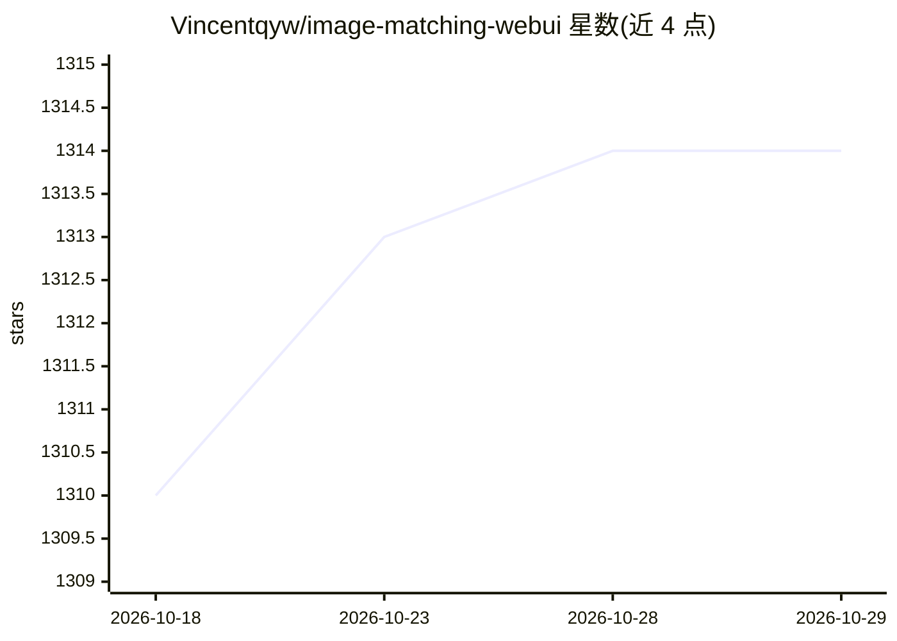

# Vincentqyw/image-matching-webui

⭐ 1,314 · Python · Apache-2.0 · 推送 2026-10-05 · [GitHub](https://github.com/Vincentqyw/image-matching-webui) · [官网](https://huggingface.co/spaces/Realcat/image-matching-webui) · 个人维护

**图像特征匹配 WebUI：多种算法比对两图关键点并可视化**

基于 Gradio 的图像匹配工具（IMCUI）：选择两张本地或摄像头图像与一种匹配算法，输出关键点匹配结果，支持 LoFTR、SuperGlue、LightGlue、SIFT 等数十种局部特征与匹配算法，并用 RANSAC 过滤外点。提供 pip 安装、Docker 镜像与命令行接口，模型权重托管于 HuggingFace；开发者可通过子模块方式接入自己的特征提取器或匹配器。代码基于 Hierarchical-Localization 构建。

## 筛选速览

| 维度 | 判定 | 备注 |
|---|---|---|
| AI 角色 | `ai-native` | 本体是模型或模型工具 |
| 许可风险 | `permissive` | Apache-2.0 |
| 部署形态 | `self-host` | docker 或自建部署 |
| 模型依赖 | — | README 未给出锁定关系 |
| 硬件要求 | — | 无带数字的原话,不猜 |
| 安装摩擦 | `low` | 无编译、无系统依赖或容器化 |
| 成熟度 | — | 结构信号不足 |

## 能力要点

- 收录数十种图像匹配算法（SuperGlue、LightGlue、LoFTR、SIFT 等）
- Gradio Web 界面支持本地图像与摄像头输入，RANSAC 过滤外点
- 支持 pip 安装、Docker 镜像与命令行接口及配置文件
- 可通过 git submodule 接入自定义特征提取器/匹配器

## 适用场景

- 可视化对比不同图像匹配算法的效果
- 为三维重建/定位任务检查图像对的特征匹配质量
- 快速试验新发表的特征提取与匹配模型

## 场景标签

`图像视频处理` · 领域:感知与多模态

## 证据(README 行号)

> L13: `Image Matching WebUI (IMCUI)` efficiently matches image pairs using multiple famous image matching algorithms. The
> L24: The tool currently supports various popular image matching algorithms, namely:

## 星数曲线

2026-10-18 1,310 → 2026-10-29 1,314（+4）

---
*卡片 v1 · prompt 1.4 · 生成 2026-10-21 · 置信度 high · 依据 README sha `4d45d3ee7bab` · [字段定义](../../DATASET.md)*
