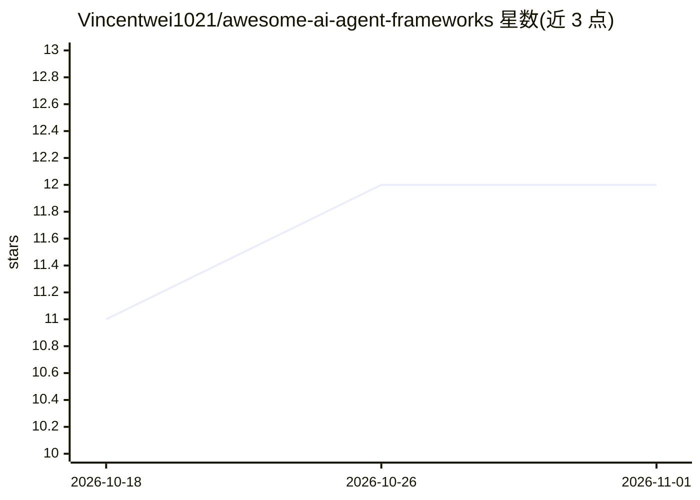

# Vincentwei1021/awesome-ai-agent-frameworks

⭐ 12 · MIT · 推送 2026-04-17 · [GitHub](https://github.com/Vincentwei1021/awesome-ai-agent-frameworks) · [官网](https://github.com/GoogleCloudPlatform/scion) · 个人维护 · 中文 README

**面向中国开发者的 AI Agent 框架中文选型指南（对比+决策树）**

一份中文 Awesome 选型指南，对 Scion、AutoGen、CrewAI、LangGraph、MetaGPT、Swarms、Dify、Coze 八个多 Agent 框架做结构化对比：总表列出架构类型、语言、学习曲线、生产就绪度与 Stars；每个框架附架构解读与代码示例；另提供 Mermaid 选型决策流程图、七种架构模式对比、按场景与按团队的推荐速查表。内容含热点追踪（Google Scion 首发解读）与相关资源清单（ADK、MCP、A2A 等）。

## 筛选速览

| 维度 | 判定 | 备注 |
|---|---|---|
| AI 角色 | `ai-knowledge` | 知识聚合/清单类 |
| 许可风险 | `permissive` | MIT |
| 部署形态 | `library` | 以包/库形式分发 |
| 模型依赖 | — | README 未给出锁定关系 |
| 硬件要求 | — | 无带数字的原话,不猜 |
| 安装摩擦 | `low` | 无编译、无系统依赖或容器化 |
| 成熟度 | — | 结构信号不足 |

## 能力要点

- 8 个主流多 Agent 框架的架构类型/学习曲线/生产就绪度总表对比
- Mermaid 选型决策流程图与按场景/按团队推荐速查表
- 每个框架附架构解读与代码示例
- Google Scion 开源的中文深度解读

## 适用场景

- 在多个多 Agent 框架之间做技术选型
- 了解不同框架的架构模式差异（对话驱动/状态图/容器编排等）
- 按团队类型或应用场景查找推荐框架

## 场景标签

`精选清单` · 领域:学习与行业

## 证据(README 行号)

> L7: > **不是又一个链接列表。** 这是一份面向中国开发者的 **AI Agent 框架深度对比 + 选型指引**，包含架构分析、代码示例和决策流程图。
> L13: |框架|开发者|架构类型|语言|适用场景|学习曲线|生产就绪度|Stars|

## 星数曲线

2026-10-18 11 → 2026-11-01 12（+1）

---
*卡片 v1 · prompt 1.4 · 生成 2026-11-01 · 置信度 high · 依据 README sha `d4f949b6bef8` · [字段定义](../../DATASET.md)*
