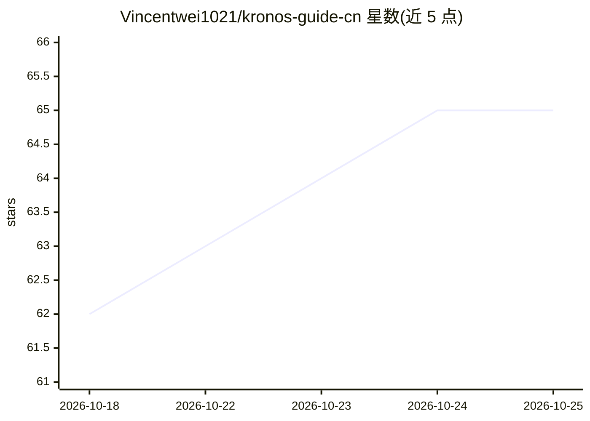

# Vincentwei1021/kronos-guide-cn

⭐ 66 · MIT · 推送 2026-04-17 · [GitHub](https://github.com/Vincentwei1021/kronos-guide-cn) · [官网](https://github.com/shiyu-coder/Kronos) · 个人维护 · 中文 README

**面向中文用户的 Kronos 金融 K 线基础模型实战指南**

围绕 Kronos（预训练于 45 个交易所、120 亿条 K 线的金融基础模型）编写的中文教程仓库，覆盖架构解读、模型家族对比、A 股数据获取（AKShare/Tushare/Baostock）、预测实战代码、基于 Qlib 数据的两阶段微调流程（含各模型 GPU 需求与训练时长）以及 Backtrader 回测集成。面向想做 A 股 K 线预测的量化开发者与研究者；指南本身不含模型代码，需配合原始 Kronos 仓库与 HuggingFace 模型使用，并声明不构成投资建议。

## 筛选速览

| 维度 | 判定 | 备注 |
|---|---|---|
| AI 角色 | `ai-knowledge` | 知识聚合/清单类 |
| 许可风险 | `permissive` | MIT |
| 部署形态 | `library` | 以包/库形式分发 |
| 模型依赖 | — | README 未给出锁定关系 |
| 硬件要求 | — | 无带数字的原话,不猜 |
| 安装摩擦 | `medium` | 含编译或系统依赖之一 |
| 成熟度 | — | 结构信号不足 |

## 能力要点

- 覆盖数据获取、预测实战、微调、回测集成的完整流程
- 三种 A 股免费/注册数据源方案及对比表
- Kronos-mini/small/base/large 四规格模型选型与微调硬件需求表
- 附预测参数调优与 FAQ（CPU 推理、OOM、无成交量数据等）

## 适用场景

- 我想用 Kronos 对 A 股做零样本 K 线预测
- 我想用 Qlib 数据微调 Kronos 适配 A 股市场
- 我想把 Kronos 预测信号接入 Backtrader 做回测

## 场景标签

`金融量化` `教程课程` · 领域:学习与行业

## 证据(README 行号)

> L3: **首个金融 K 线基础模型，预训练于 45 个全球交易所、120 亿条 K 线数据。零样本预测 RankIC 比最强 TSFM 高 93%。**
> L11: > **全网首份中文实战指南** | 原始项目：GitHub Stars | 论文：arXiv 2508.02739 | Live Demo
> L13: ## 📖 目录

## 星数曲线

2026-10-18 62 → 2026-10-25 65（+3）

---
*卡片 v1 · prompt 1.4 · 生成 2026-10-24 · 置信度 mid · 依据 README sha `eb3de1f7e0e1` · [字段定义](../../DATASET.md)*
