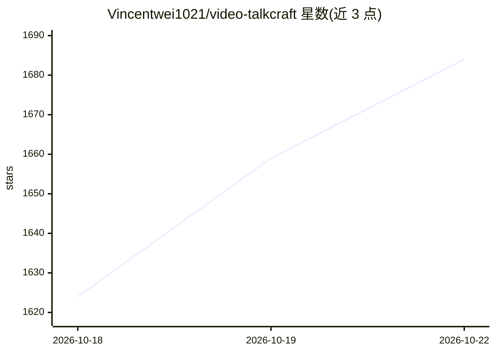

# Vincentwei1021/video-talkcraft

⭐ 1,684 · HTML · NOASSERTION · 推送 2026-10-12 · [GitHub](https://github.com/Vincentwei1021/video-talkcraft) · [官网](https://vincentwei1021.github.io/video-talkcraft/) · 个人维护 · 中文 README

**把 Claude Code/Codex 变成口播视频动效工作室的 agent skill**

面向 Claude Code / Codex 的 AI agent 技能包：输入口播稿与成品配音，在本机完成字级时间戳对齐（默认 FireRedASR2-CTC int8 CPU 路径，备选 faster-whisper），生成 SHOTBOOK 分镜，从 108 张动效配方卡中选卡并用 Remotion 渲染解说成片。含七层反 PPT 镜头系统、三重验收管线、多轨后期工作台与分段并行渲染脚本。可选接入 Fish Audio 生成配音与时间戳。许可为 PolyForm Noncommercial，个人/教育/研究免费，商业使用需授权。

## 筛选速览

| 维度 | 判定 | 备注 |
|---|---|---|
| AI 角色 | `ai-ecosystem` | LLM/agent 周边工具 |
| 许可风险 | `none` | NOASSERTION |
| 部署形态 | `library` | 以包/库形式分发 |
| 模型依赖 | — | README 未给出锁定关系 |
| 硬件要求 | — | 无带数字的原话,不猜 |
| 安装摩擦 | `medium` | 含编译或系统依赖之一 |
| 成熟度 | — | 结构信号不足 |

## 能力要点

- 字级配音同步：CPU 对齐路径实测字级偏差中位 20–40ms
- 108 张动效配方卡，每张含自包含 Remotion tsx 源码与 HTML 预览
- 七层反 PPT 镜头系统与三重验收（静止检测、音效能量验证、独立评审）
- 分段渲染母版制：改一个镜头 53s 出有声新片（201s 竖屏片实测）

## 适用场景

- 把口播稿和配音自动做成带动效的解说视频
- 在 Claude Code / Codex 里用自然语言驱动整条视频生产管线
- 逐镜微调成片的字幕、转场、音效与镜头后再导出

## 场景标签

`视频生成` · 领域:内容生成

## 证据(README 行号)

> L14: 系列的口播视频篇：一个把 Claude Code / Codex 变成口播视频动效工作室的 AI agent skill。
> L203: 一个开源的 AI agent skill（Claude Code / Codex 技能包），用于 AI 视频制作：

## 星数曲线

2026-10-18 1,624 → 2026-10-22 1,684（+60）

---
*卡片 v1 · prompt 1.4 · 生成 2026-10-21 · 置信度 mid · 依据 README sha `9e316dcd5caf` · [字段定义](../../DATASET.md)*
