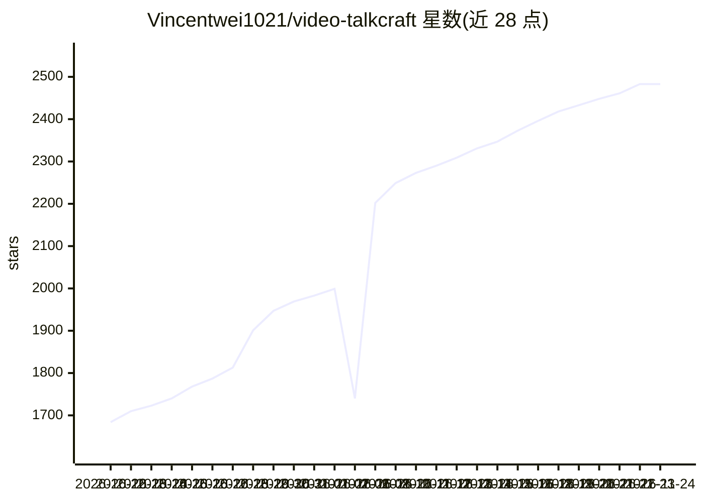

# Vincentwei1021/video-talkcraft

⭐ 2,483 · HTML · NOASSERTION · 推送 2026-11-21 · [GitHub](https://github.com/Vincentwei1021/video-talkcraft) · [官网](https://vincentwei1021.github.io/video-talkcraft/) · 个人维护 · 中文 README

**把 Claude Code/Codex 变成口播视频动效工作室的 agent skill**

video-shotcraft 系列的口播视频篇：输入口播稿与成品配音，本机做字级时间戳对齐（默认 FireRedASR2-CTC int8，备选 faster-whisper），按语义拍生成 SHOTBOOK 分镜，再用 Remotion 渲染成片，含 108 张动效配方卡、七层反 PPT 镜头系统与三重验收。依赖 Node 18+、Python 3.10+、ffmpeg。PolyForm Noncommercial 1.0.0 许可，商业用途需授权。

## 筛选速览

| 维度 | 判定 | 备注 |
|---|---|---|
| AI 角色 | `ai-native` | 本体是模型或模型工具 |
| 许可风险 | `none` | NOASSERTION |
| 部署形态 | `library` | 以包/库形式分发 |
| 模型依赖 | — | README 未给出锁定关系 |
| 硬件要求 | — | 无带数字的原话,不猜 |
| 安装摩擦 | `medium` | 含编译或系统依赖之一 |
| 成熟度 | — | 结构信号不足 |

## 能力要点

- 字级配音同步：CPU 时间戳对齐，字级偏差中位 20–40ms
- 108 张动效配方卡，各带自包含 Remotion tsx 源码与 HTML 预览
- 三重验收：静止段检测、音效逐 cue 验证、独立评审
- 可选 Fish Audio TTS 生成配音与字级时间戳

## 适用场景

- 把口播稿和配音自动做成带动效的解说视频
- 知识科普、产品评测、新闻解读类视频制作
- 中英混排口播视频的字级动效同步
- 用剪映/PR/AE 叠加导出的透明通道素材

## 场景标签

`视频生成` · 领域:内容生成

## 证据(README 行号)

> L15: 系列的口播视频篇：一个把 Claude Code / Codex 变成口播视频动效工作室的 AI agent skill。
> L89: - **字级配音同步**——`scripts/timestamps_cpu.py` 把口播稿对齐到音频
> L204: 一个开源的 AI agent skill（Claude Code / Codex 技能包），用于 AI 视频制作：

## 星数曲线

2026-10-22 1,684 → 2026-11-24 2,483（+799）

---
*卡片 v1 · prompt 1.4 · 生成 2026-11-23 · 置信度 mid · 依据 README sha `d184014f463f` · [字段定义](../../DATASET.md)*
