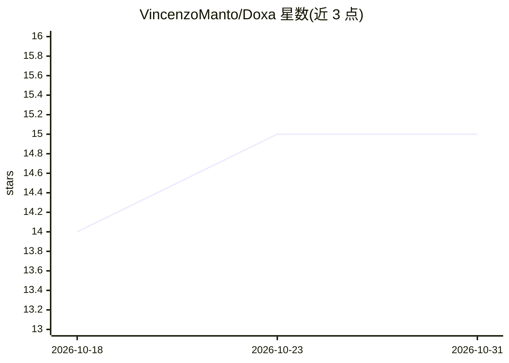

# VincenzoManto/Doxa

⭐ 15 · Python · GPL-3.0 · 推送 2026-07-10 · [GitHub](https://github.com/VincenzoManto/Doxa) · [官网](https://vincenzomanto.github.io/Doxa/) · 个人维护

**给科研者：用 YAML 声明式驱动 LLM 多智能体社会经济仿真**

面向计算经济学与社会科学研究的多智能体仿真平台：以 YAML 场景文件作为唯一配置来源，组合 LLM 驱动的智能体、市场微观结构（OTC/LOB/做市商）、信任关系图与世界事件系统，经 FastAPI 后端与 React 客户端运行。提供 Docker、本地开发、PyPI 后端包与 Colab 四种安装路径，内置霍尔木兹、信息扩散、金融市场等示例场景。引擎对场景文件做严格校验，仿真运行由 YAML 与引擎版本完全确定。限制：大规模智能体可扩展性、无原生分布式执行、高级推理依赖外部 LLM API。

## 筛选速览

| 维度 | 判定 | 备注 |
|---|---|---|
| AI 角色 | `ai-ecosystem` | LLM/agent 周边工具 |
| 许可风险 | `viral` | GPL-3.0 |
| 部署形态 | `self-host` | docker 或自建部署 |
| 模型依赖 | local-ok | 支持本地模型 |
| 硬件要求 | — | 无带数字的原话,不猜 |
| 安装摩擦 | `low` | 无编译、无系统依赖或容器化 |
| 成熟度 | — | 结构信号不足 |

## 能力要点

- YAML 声明式场景规范，含 global_rules/actors/world_events 字段并严格校验
- LLM 智能体（支持 OpenAI、Google、Ollama 等）与市场微观结构、信任图、世界事件子系统
- FastAPI REST/WebSocket 端点支持批量操作与实时数据流
- RAG 记忆、协商协议工具与原子化资源转移

## 适用场景

- 做价格发现、流动性冲击等经济市场实验
- 研究社会传染与信任动态
- 用 AI 智能体做谈判与联盟形成实验
- 政策评估与压力测试

## 场景标签

`多智能体` `科研工具` · 领域:Agent 开发

## 证据(README 行号)

> L5: Doxa is a YAML-driven multi-agent simulation platform for economic and social systems. It combines LLM-backed agents
> L45: Doxa is a modular, extensible platform for multi-agent simulation, integrating generative AI, economic modeling, an
> L56: - Generative AI integration (OpenAI, Google, Ollama, etc.)

## 星数曲线

2026-10-18 14 → 2026-10-31 15（+1）

---
*卡片 v1 · prompt 1.4 · 生成 2026-10-30 · 置信度 high · 依据 README sha `e97b69d5ae13` · [字段定义](../../DATASET.md)*
