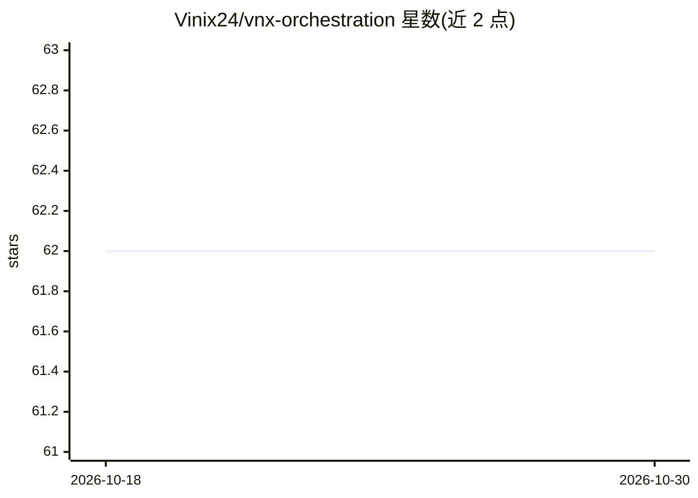

# Vinix24/vnx-orchestration

⭐ 62 · Python · MIT · 推送 2026-10-29 · [GitHub](https://github.com/Vinix24/vnx-orchestration) · [官网](https://vincentvandeth.nl/blog/glass-box-governance-multi-agent-ai) · 个人维护

**面向治理的 AI 编码 CLI 编排运行时：并行 worker、审计回执、质量门**

本地控制平面，以子进程方式驱动机器上已安装的编码 CLI（claude、codex、gemini、kimi、本地 ollama），不导入任何厂商 SDK。每个 worker 在独立 git worktree 中运行，经审查门决定合并，每次派发生成 append-only NDJSON 回执，可重构从分配到合并的全过程。订阅型 CLI 走已有订阅计费，GLM/DeepSeek/OpenRouter 走 API credit。需前置安装并认证相应 CLI，默认 lane 要求 GitHub origin 与 gh 认证。以 pip 包提供，另有 checkout 运算符命令需源码安装。

## 筛选速览

| 维度 | 判定 | 备注 |
|---|---|---|
| AI 角色 | `ai-ecosystem` | LLM/agent 周边工具 |
| 许可风险 | `permissive` | MIT |
| 部署形态 | `library` | 以包/库形式分发 |
| 模型依赖 | local-ok | 支持本地模型 |
| 硬件要求 | — | 无带数字的原话,不猜 |
| 安装摩擦 | `low` | 无编译、无系统依赖或容器化 |
| 成熟度 | `idea` | |

## 能力要点

- 每次派发产生 append-only NDJSON 回执，含成本记录与哈希链校验工具（可选）
- 以子进程驱动 claude/codex/gemini/kimi/ollama，不使用厂商 SDK
- per-worker git worktree 隔离与不可跳过的审查门（gate 未全读记 partial_review 拒合并）
- vnx init/migrate/doctor/dispatch-agent 等 CLI 命令集

## 适用场景

- 编排多个 AI 编码 CLI 并行执行开发任务并留审计轨迹
- 对 AI agent 的每次派发做成本与来源治理
- 用订阅而非按次 API 计费运行编码 agent

## 场景标签

`多智能体` `编码 Agent` `LLM 可观测性` · 领域:Agent 开发

## 证据(README 行号)

> L18: VNX runs AI coding CLI workers in isolated git worktrees, through review gates, with an append-only NDJSON receipt 
> L20: It is a local control plane for the AI coding CLIs that already sit on your machine. One orchestrator dispatches wo
> L106: VNX does not run models itself: it drives existing coding CLIs as subprocesses and governs the

## 星数曲线

2026-10-18 62 → 2026-10-30 62（+0）

---
*卡片 v1 · prompt 1.4 · 生成 2026-10-24 · 置信度 high · 依据 README sha `bffb57deec12` · [字段定义](../../DATASET.md)*
