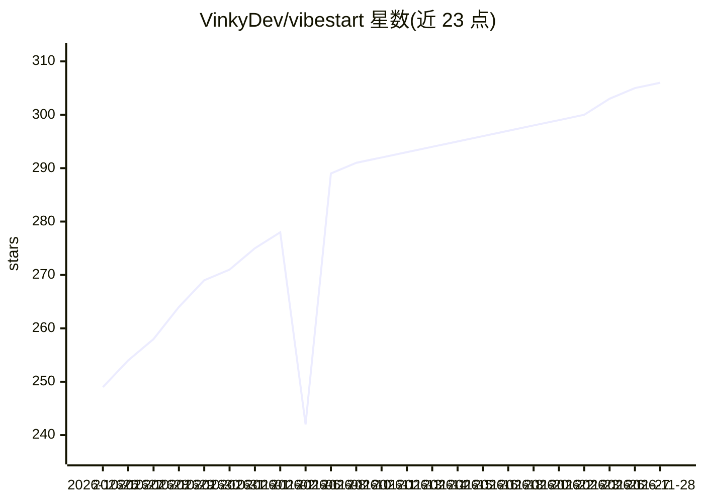

# VinkyDev/vibestart

⭐ 306 · TypeScript · MIT · 推送 2026-11-27 · [GitHub](https://github.com/VinkyDev/vibestart) · [官网](https://vibestart.net) · 个人维护 · 中文 README

**为 AI 编码智能体生成经过验证的全栈 TypeScript 项目**

一个 CLI 与 Web Studio 组合的项目脚手架工具：开发者逐层选择应用框架、后端、数据库、ORM、认证、测试等组件，CLI 生成完整 TypeScript 项目，内置类型检查、lint、测试与构建。每个受支持的组合在发布前经 CI 安装、类型检查、测试并记录验证指纹；生成项目包含 AGENTS.md 规则文件供编码智能体遵循，并支持通过 upgrade 三方合并保持模板更新。生成项目对 VibeStart 无运行时依赖。

## 筛选速览

| 维度 | 判定 | 备注 |
|---|---|---|
| AI 角色 | `ai-ecosystem` | LLM/agent 周边工具 |
| 许可风险 | `permissive` | MIT |
| 部署形态 | `self-host` | docker 或自建部署 |
| 模型依赖 | — | README 未给出锁定关系 |
| 硬件要求 | — | 无带数字的原话,不猜 |
| 安装摩擦 | `low` | 无编译、无系统依赖或容器化 |
| 成熟度 | — | 结构信号不足 |

## 能力要点

- npx vibestart-cli 交互式组合技术栈并生成项目
- 每个组合经 CI 验证，验证记录以指纹存于 verification 分支
- npx skills add 安装技能供 Claude Code/Codex/Cursor 等 agent 使用
- upgrade 三方合并模板更新，保留用户代码

## 适用场景

- 让编码智能体从一个规范、带检查的代码库开始新项目
- 快速组合 TypeScript 全栈技术栈而不逐个拼装配置
- 生成后持续同步上游模板更新

## 场景标签

`代码生成` · 领域:编码与开发

## 证据(README 行号)

> L5: Compose a full-stack TypeScript stack and get a cutting-edge, verified project made for AI coding agents, with type 
> L31: npx skills add VinkyDev/vibestart --skill vibestart
> L34: The agent installs the vibestart skill, chooses the stack, and creates the project. See the Agent Skills guide.

## 星数曲线

2026-10-26 249 → 2026-11-28 306（+57）

---
*卡片 v1 · prompt 1.4 · 生成 2026-11-27 · 置信度 mid · 依据 README sha `8bb4ac9757e1` · [字段定义](../../DATASET.md)*
