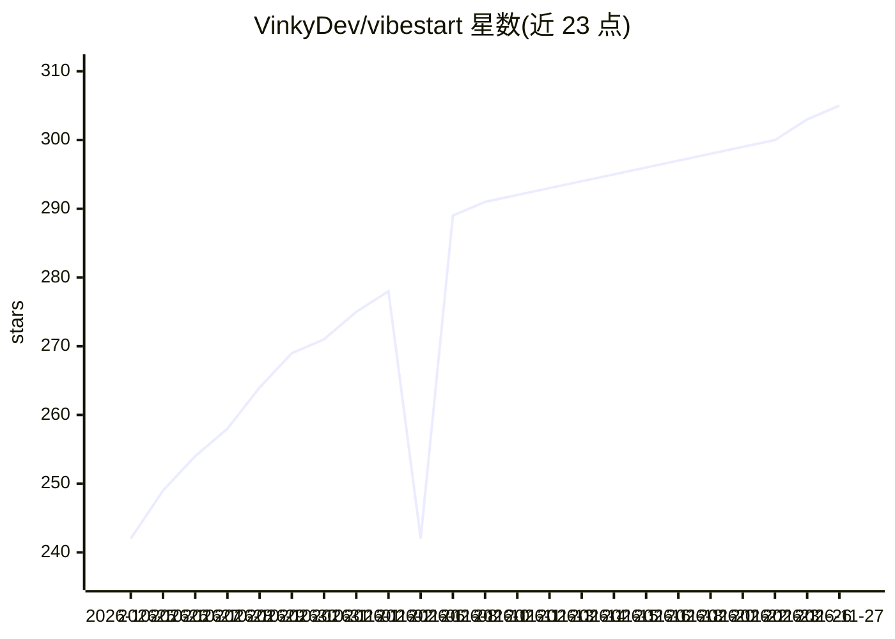

# VinkyDev/vibestart

⭐ 305 · TypeScript · MIT · 推送 2026-11-26 · [GitHub](https://github.com/VinkyDev/vibestart) · [官网](https://vibestart.net) · 个人维护

**为 AI 编码智能体生成经验证的全栈 TypeScript 项目**

通过 CLI 或 Web Studio 组合选择各层技术（应用框架、后端、ORM、认证、部署、UI、测试等），生成带类型安全、lint 与测试的全栈 TypeScript 项目。每个技术项以集成形式组合，不兼容的组合会被拒绝并给出原因与最小修复建议；发布前 CI 对每个受支持组合进行安装、类型检查、lint、测试、浏览器测试与构建验证。生成的项目为普通仓库，无对 VibeStart 的运行时依赖，并可通过 upgrade 进行三方合并式模板更新。

## 筛选速览

| 维度 | 判定 | 备注 |
|---|---|---|
| AI 角色 | `ai-ecosystem` | LLM/agent 周边工具 |
| 许可风险 | `permissive` | MIT |
| 部署形态 | `library` | 以包/库形式分发 |
| 模型依赖 | — | README 未给出锁定关系 |
| 硬件要求 | — | 无带数字的原话,不猜 |
| 安装摩擦 | `low` | 无编译、无系统依赖或容器化 |
| 成熟度 | — | 结构信号不足 |

## 能力要点

- 按层自由组合技术栈，不兼容组合被拒绝并给出修复建议
- 每个受支持组合经 CI 安装/类型检查/lint/测试/构建验证并记录指纹
- 生成的项目含 AGENTS.md 规则与快速检查（vp run ready）
- upgrade 三方合并模板更新，保留用户应用代码

## 适用场景

- 用编码智能体（如 Claude Code、Cursor）快速启动全栈 TypeScript 项目
- 获取各层均为当前标准的、经组合验证的项目脚手架
- 长期维护生成项目并安全合并模板更新

## 场景标签

`代码生成` · 领域:编码与开发

## 证据(README 行号)

> L5: Compose a full-stack TypeScript stack and get a cutting-edge, verified project made for AI coding agents, with type 
> L28: Paste this command, along with what you want to build, into Claude Code, Codex, Cursor, or any coding agent:

## 星数曲线

2026-10-25 242 → 2026-11-27 305（+63）

---
*卡片 v1 · prompt 1.4 · 生成 2026-11-25 · 置信度 high · 依据 README sha `f57a27df64a8` · [字段定义](../../DATASET.md)*
