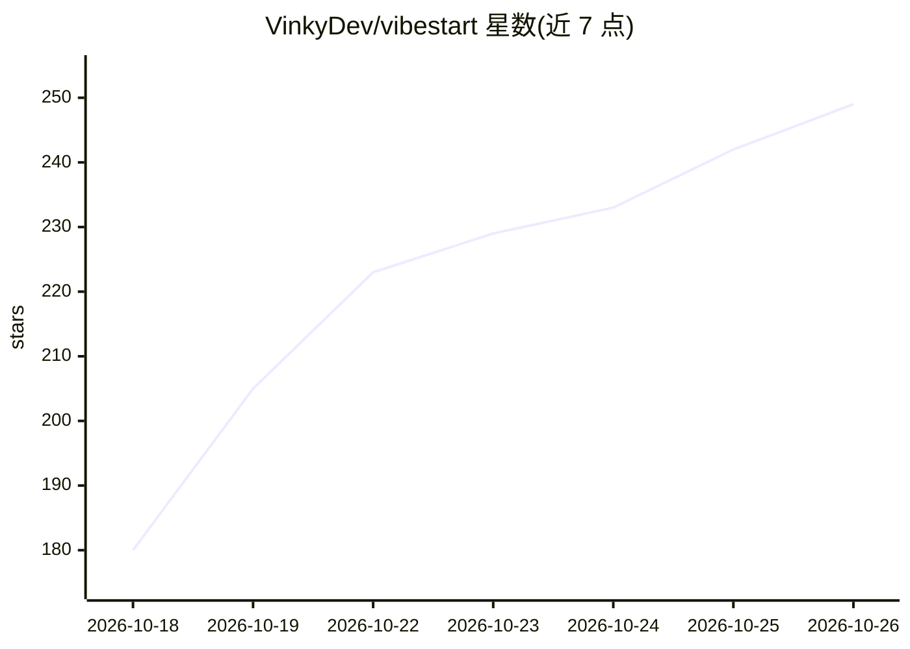

# VinkyDev/vibestart

⭐ 249 · TypeScript · MIT · 推送 2026-10-23 · [GitHub](https://github.com/VinkyDev/vibestart) · [官网](https://vibestart.net) · 个人维护 · 中文 README

**为 AI 编码智能体生成经验证的全栈 TypeScript 项目脚手架**

通过 Web studio 或终端问答组合全栈 TypeScript 技术栈，CLI 生成带有类型安全、lint、测试与 AGENTS.md 规则的项目，供 AI 编码智能体在其上持续开发。每个技术选型为独立集成，不兼容组合会被拒绝并给出最小修改建议；发布前所有支持的组合在 CI 中经过安装、类型检查、lint、测试、浏览器测试与构建验证。生成的项目是普通仓库，对 VibeStart 无运行时依赖；`upgrade` 命令可在保留用户代码的前提下更新模板。

## 筛选速览

| 维度 | 判定 | 备注 |
|---|---|---|
| AI 角色 | `ai-ecosystem` | LLM/agent 周边工具 |
| 许可风险 | `permissive` | MIT |
| 部署形态 | `library` | 以包/库形式分发 |
| 模型依赖 | — | README 未给出锁定关系 |
| 硬件要求 | — | 无带数字的原话,不猜 |
| 安装摩擦 | `low` | 无编译、无系统依赖或容器化 |
| 成熟度 | — | 结构信号不足 |

## 能力要点

- 按层组合技术栈，无法工作的组合会被拒绝并给出修复建议
- 所有支持组合在 CI 中经过安装/检查/测试/构建验证并记录指纹
- 每项目附带 AGENTS.md 与 `vp run ready` 一键运行 types/lint/tests
- 可通过 `npx skills add` 作为技能安装给 Claude Code 等 agent 使用

## 适用场景

- 我需要为 AI 编码智能体准备一个规范的全栈 TypeScript 起点
- 我想自由组合框架/ORM/数据库等选型并确保组合经过验证
- 我想让 agent 直接安装技能并代为选型建项目

## 场景标签

`代码生成` · 领域:编码与开发

## 证据(README 行号)

> L5: Compose a full-stack TypeScript stack and get a cutting-edge, verified project made for AI coding agents, with type 
> L27: Paste this command, along with what you want to build, into Claude Code, Codex, Cursor, or any coding agent:
> L33: The agent installs the vibestart skill, chooses the stack, and creates the project. Later, ask it to add capabiliti

## 星数曲线

2026-10-18 180 → 2026-10-26 249（+69）

---
*卡片 v1 · prompt 1.4 · 生成 2026-10-22 · 置信度 high · 依据 README sha `efb57d46f269` · [字段定义](../../DATASET.md)*
