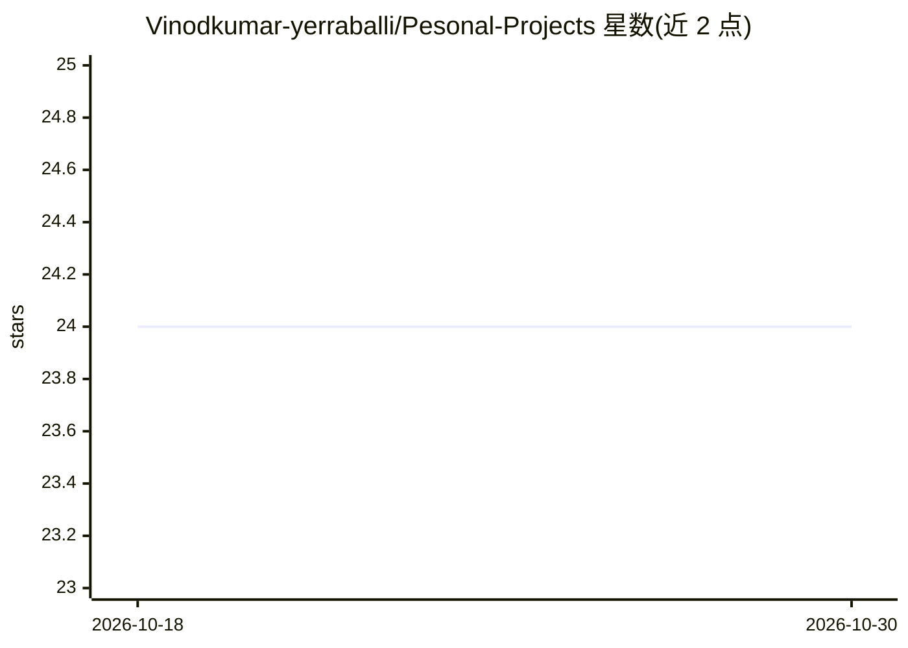

# Vinodkumar-yerraballi/Pesonal-Projects

⭐ 24 · Jupyter Notebook · 推送 2026-07-28 · [GitHub](https://github.com/Vinodkumar-yerraballi/Pesonal-Projects) · 个人维护

**个人数据科学与机器学习项目作品集（Jupyter 笔记本合集）**

个人作品集仓库，收录数据分析、机器学习、NLP 与商业问题求解的实操项目：包括信用卡欺诈检测、信贷违约预测、航班延误与房价预测、销售分析、垃圾短信检测、情感分析及 Netflix 数据分析等 EDA 项目。工具栈为 Python、Jupyter Notebook、Pandas/NumPy、Matplotlib/Seaborn/Plotly、Scikit-learn、TensorFlow/Keras 与 NLTK/SpaCy。使用方式为克隆仓库后在 Jupyter 中逐个浏览笔记本，查看从数据加载到模型评估的流程。

## 筛选速览

| 维度 | 判定 | 备注 |
|---|---|---|
| AI 角色 | `ai-knowledge` | 知识聚合/清单类 |
| 许可风险 | `none` | — |
| 部署形态 | `None` |  |
| 模型依赖 | — | README 未给出锁定关系 |
| 硬件要求 | — | 无带数字的原话,不猜 |
| 安装摩擦 | `low` | 无编译、无系统依赖或容器化 |
| 成熟度 | — | 结构信号不足 |

## 能力要点

- 覆盖分类/回归预测、销售分析与 NLP 文本分类等多类项目
- 使用 Pandas、Scikit-learn、TensorFlow/Keras 等工具栈
- 以 Jupyter Notebook 形式呈现从数据加载到模型评估的完整流程

## 适用场景

- 浏览参考他人的数据科学与机器学习实操项目
- 查找 EDA 与预测建模的笔记本示例
- 了解求职向数据科学作品集的组织方式

## 场景标签

`数据分析` · 领域:效率与自动化

## 证据(README 行号)

> L3: This repository showcases a collection of hands-on projects focused on data analysis, machine learning, NLP, and bus
> L14: ## Featured Projects

## 星数曲线

2026-10-18 24 → 2026-10-30 24（+0）

---
*卡片 v1 · prompt 1.4 · 生成 2026-10-27 · 置信度 mid · 依据 README sha `f576ce66cd4d` · [字段定义](../../DATASET.md)*
