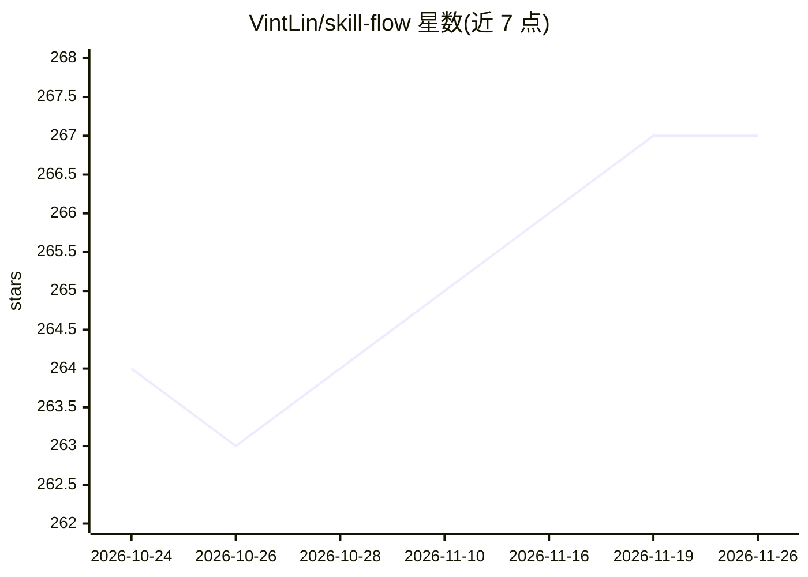

# VintLin/skill-flow

⭐ 267 · TypeScript · Apache-2.0 · 推送 2026-11-25 · [GitHub](https://github.com/VintLin/skill-flow) · 个人维护 · 中文 README

**跨编程 Agent 统一安装与管理 skills 的 CLI/桌面工具**

面向使用多种编码 Agent 的开发者，将分散的 AI agent skills 以工作流组为单位统一管理：从 skills.sh、GitHub、本地目录等来源导入，一次部署到 32 个内置目标（Claude Code、Cursor、Copilot 等），用 manifest.json/lock.json 双文件记录意图与实际部署状态，并提供 doctor/repair 系列命令诊断漂移与修复状态。提供 npm 安装的 Ink 交互式 CLI（需 Node.js 22+）与 macOS 15+ 的 SwiftUI 桌面应用，桌面端通过版本化 JSON bridge 协议与 CLI 通信。

## 筛选速览

| 维度 | 判定 | 备注 |
|---|---|---|
| AI 角色 | `ai-ecosystem` | LLM/agent 周边工具 |
| 许可风险 | `permissive` | Apache-2.0 |
| 部署形态 | `desktop` | 安装包/桌面程序 |
| 模型依赖 | — | README 未给出锁定关系 |
| 硬件要求 | — | 无带数字的原话,不猜 |
| 安装摩擦 | `low` | 无编译、无系统依赖或容器化 |
| 成熟度 | — | 结构信号不足 |

## 能力要点

- 一次将所选 skill 集合部署到 32 个内置 Agent 目标
- manifest.json 与 lock.json 显式记录期望与实际部署状态
- doctor 与 repair-source/state/targets 诊断与修复命令
- Ink 交互式 TUI 与 skill-flow bridge --json 机器协议

## 适用场景

- 在多个编码 Agent 中同步部署同一组 skills
- 管理来自 skills.sh 与 GitHub 的技能组更新，避免版本漂移
- 排查和修复各 Agent 目标目录中失效的技能部署

## 场景标签

 · 领域:开发工具/Agent 技能管理

## 证据(README 行号)

> L13: Install, manage, and share skills across every major coding agent — Claude Code, Cursor, Grok Build, Copilot, Kimi 
> L34: - **Multi-agent deployment**: deploy one selected skill set to Claude Code, Codex, Cursor, Grok Build, Gemini CLI, 

## 星数曲线

2026-10-24 264 → 2026-11-26 267（+3）

---
*卡片 v1 · prompt 1.4 · 生成 2026-11-26 · 置信度 high · 依据 README sha `3eced352effb` · [字段定义](../../DATASET.md)*
