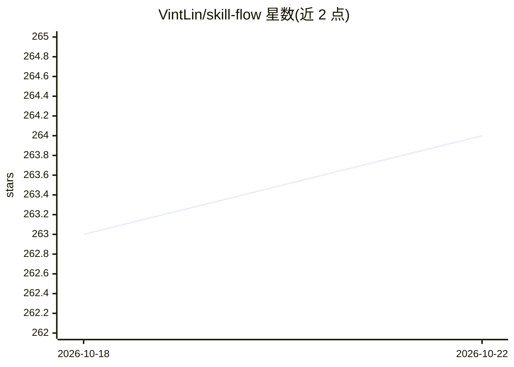

# VintLin/skill-flow

⭐ 264 · TypeScript · Apache-2.0 · 推送 2026-10-22 · [GitHub](https://github.com/VintLin/skill-flow) · 个人维护

**跨编码 Agent 的技能安装与管理工具（CLI + macOS 桌面端）**

面向使用多种编码 Agent 的开发者：以 npm CLI 和 macOS 15+ SwiftUI 桌面应用两种形式，统一导入、部署、更新和卸载 AI agent 技能。支持从本地目录、GitHub、HTTPS/SSH Git URL 及 skills.sh（clawhub）导入技能源，按技能组一次性部署到 32 个内置目标（Claude Code、Codex、Cursor、Copilot 等）。状态由 manifest.json（意图）与 lock.json（实际安装）双文件管理，提供 doctor/repair-* 诊断修复命令和版本化 JSON bridge 协议。macOS 桌面版提供 dmg 发布包，未配置 Apple 开发者证书需手动处理隔离属性。

## 筛选速览

| 维度 | 判定 | 备注 |
|---|---|---|
| AI 角色 | `ai-ecosystem` | LLM/agent 周边工具 |
| 许可风险 | `permissive` | Apache-2.0 |
| 部署形态 | `desktop` | 安装包/桌面程序 |
| 模型依赖 | — | README 未给出锁定关系 |
| 硬件要求 | — | 无带数字的原话,不猜 |
| 安装摩擦 | `low` | 无编译、无系统依赖或容器化 |
| 成熟度 | — | 结构信号不足 |

## 能力要点

- 统一导入模型覆盖本地/Git/skills.sh 三类技能源
- 一次部署到 32 个内置编码 Agent 目标
- manifest/lock 双文件显式状态管理与 repair/doctor 修复命令
- macOS 桌面应用含安全退出恢复与菜单栏快捷配置

## 适用场景

- 同时在多个编码 Agent 间安装和同步技能
- 批量管理 GitHub 技能仓库的导入、选择与更新
- 诊断和修复技能部署漂移问题

## 场景标签

`提示工程` · 领域:Agent 开发

## 证据(README 行号)

> L13: Install, manage, and share skills across every major coding agent — Claude Code, Cursor, Grok Build, Copilot, Kimi 
> L33: - **Grouped source management**: local, Git, and skills.sh sources all flow through the same import model.
> L34: - **Multi-agent deployment**: deploy one selected skill set to Claude Code, Codex, Cursor, Grok Build, Gemini CLI, 

## 星数曲线

2026-10-18 263 → 2026-10-22 264（+1）

---
*卡片 v1 · prompt 1.4 · 生成 2026-10-22 · 置信度 high · 依据 README sha `08a648c6d3a8` · [字段定义](../../DATASET.md)*
