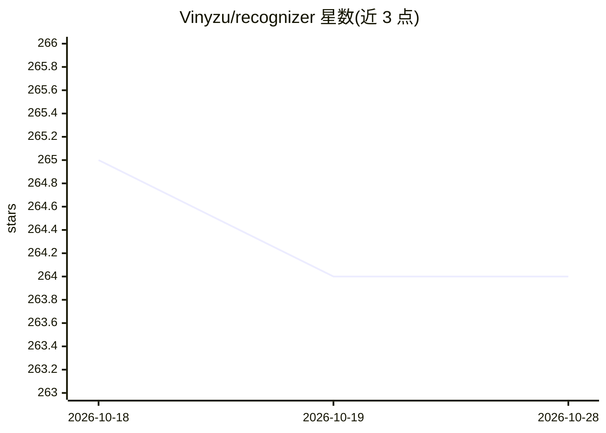

# Vinyzu/recognizer

⭐ 263 · Python · GPL-3.0 · 推送 2026-03-29 · [GitHub](https://github.com/Vinyzu/recognizer) · 个人维护

**用 YOLO 与 CLIP 模型自动解 reCAPTCHA 验证码的 Python 库**

基于深度学习模型（YOLO11m-seg 目标分割、flavour/CLIP ViT-L/14、CIDAS/clipseg）的 reCAPTCHA 图像挑战求解库，通过 pip 安装，提供易用 API 及 Playwright 同步/异步两种集成方式。支持多种输入格式：整页截图、仅验证码图像、无边框图像或图像列表。README 声明需配合 Patchright 或 Botright 等反检测浏览器引擎才能稳定通过，普通 Playwright 易被识别；仅供教育用途，GPL 许可允许商用但需保留源码与版权声明。

## 筛选速览

| 维度 | 判定 | 备注 |
|---|---|---|
| AI 角色 | `ai-native` | 本体是模型或模型工具 |
| 许可风险 | `viral` | GPL-3.0 |
| 部署形态 | `library` | 以包/库形式分发 |
| 模型依赖 | — | README 未给出锁定关系 |
| 硬件要求 | — | 无带数字的原话,不猜 |
| 安装摩擦 | `low` | 无编译、无系统依赖或容器化 |
| 成熟度 | — | 结构信号不足 |

## 能力要点

- 基于 YOLO11m-seg、CLIP ViT-L/14 与 clipseg 的验证码图像识别
- 提供 Sync/Async Playwright 集成（SyncChallenger 等代理）
- 接受整页截图、无框图像、图像列表等多种输入格式

## 适用场景

- 在 Playwright 自动化流程中自动求解 reCAPTCHA 图像挑战
- 通过 API 批量识别验证码图像内容

## 场景标签

 · 领域:浏览器自动化/验证码识别

## 证据(README 行号)

> L16: #### reCognizer is a free-to-use AI based reCaptcha Solver. Usable with an easy-to-use API, also available for Asyn
> L74: YOLO11m-seg

## 星数曲线

2026-10-18 265 → 2026-10-28 264（-1）

---
*卡片 v1 · prompt 1.4 · 生成 2026-10-22 · 置信度 high · 依据 README sha `e4fd2922cb6a` · [字段定义](../../DATASET.md)*
