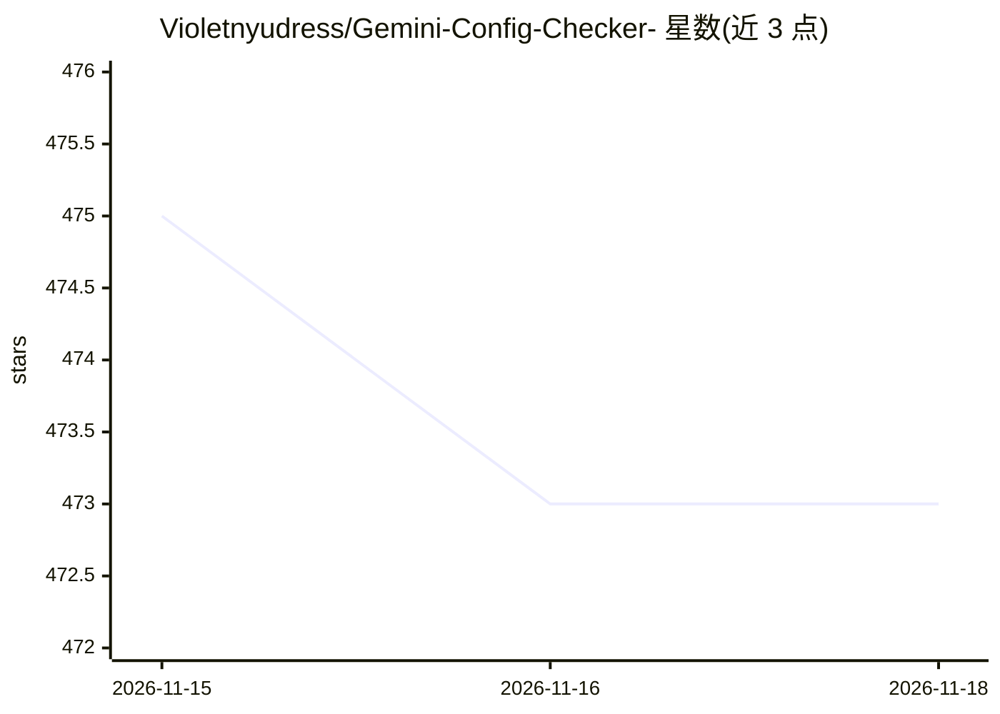

# Violetnyudress/Gemini-Config-Checker-

⭐ 473 · Go · Apache-2.0 · 推送 2026-11-15 · [GitHub](https://github.com/Violetnyudress/Gemini-Config-Checker-) · 个人维护

**检测代理配置能否进入 AI Studio/Gemini 的地区扫描工具**

跨平台代理配置扫描器（Windows/macOS/Linux/Android，Wails 桌面壳 + 内嵌 Xray-core）：以登录 Google 账号的浏览器实际访问 AI Studio 与 Gemini，读取 Google 的地区封锁判定（普通连通性探测无法反映按账号地区限制）。Simple 模式测试自有配置，Advanced 模式将免费配置链在可用基础配置后寻找其他出口；支持 vless/vmess/trojan/ss 链接、订阅与 base64 输入，并可应用可编辑的 anti-DPI 分片配置。限早期 0.1.0 版，仅在 Windows 上完整运行过；地区检查需 Chrome/Edge/Brave，Android 仅连通性模式。

## 筛选速览

| 维度 | 判定 | 备注 |
|---|---|---|
| AI 角色 | `ai-enhanced` | 去掉 AI 部分产品仍成立 |
| 许可风险 | `permissive` | Apache-2.0 |
| 部署形态 | `desktop` | 安装包/桌面程序 |
| 模型依赖 | — | README 未给出锁定关系 |
| 硬件要求 | — | 无带数字的原话,不猜 |
| 安装摩擦 | `medium` | 含编译或系统依赖之一 |
| 成熟度 | `idea` | |

## 能力要点

- 以登录账号浏览器读取 Google 的逐账号地区判定，替代不可靠的 HTTP 探测
- Simple/Advanced 双模式，Advanced 将免费配置链在基础配置后换出口
- anti-DPI 分片配置（Finalmask/ALPN/密码套件）可编辑并可在本地转发器中复现 PattN 分叉算法
- 输出链接/base64/Xray 链式配置导出，附 SHA256 校验文件

## 适用场景

- 测试手头代理配置哪些能真正打开 AI Studio 和 Gemini
- Cloudflare 配置可连但被 Google 封出口时，链式寻找可用出口
- 在过滤网络中带 anti-DPI 配置测试连通性

## 场景标签

 · 领域:网络工具/代理配置测试

## 证据(README 行号)

> L11: Find proxy configs that actually get you into **Google AI Studio and Gemini**, by testing each one the way a person
> L50: Google decides region availability **per signed-in account, after the page has loaded**. A plain HTTP request (even

## 星数曲线

2026-11-15 475 → 2026-11-18 473（-2）

---
*卡片 v1 · prompt 1.4 · 生成 2026-11-17 · 置信度 mid · 依据 README sha `846e83cebb20` · [字段定义](../../DATASET.md)*
