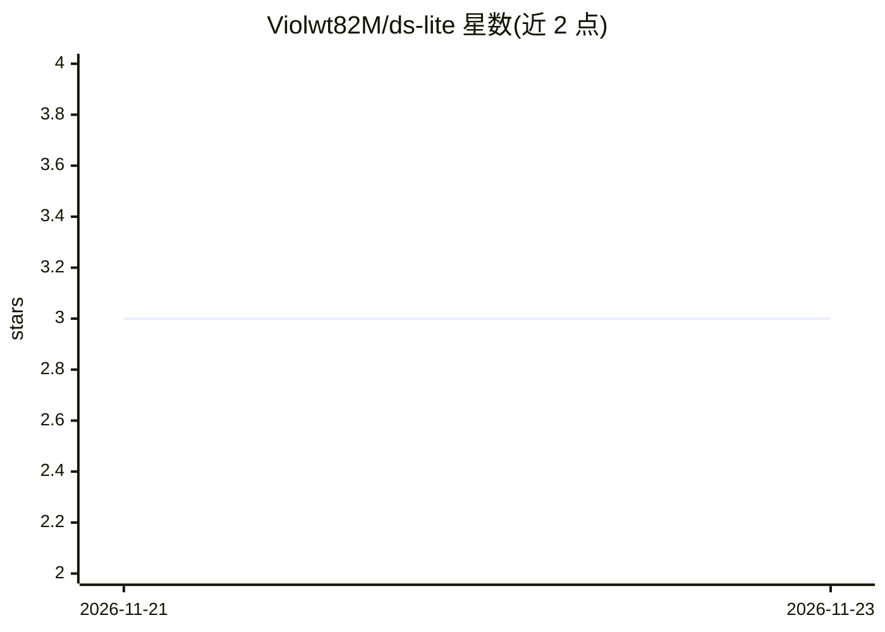

# Violwt82M/ds-lite

⭐ 3 · TypeScript · MIT · 推送 2026-11-22 · [GitHub](https://github.com/Violwt82M/ds-lite) · [官网](https://Violwt82M.github.io/ds-lite/) · 个人维护 · 中文 README

**自备 API Key 的免费开源 DeepSeek 安卓聊天客户端**

基于 DeepSeek 官方开源前端 chat-demo（MIT）适配打包的安卓 APK，不属于官方产品；不含 API Key、不代理请求、无服务器，用户填自己的 Key 按量计费。在上游功能（多会话、流式输出、深度思考、联网搜索引用、附件与语音、Markdown/KaTeX/Mermaid）之上增加：上下文占用四档常驻显示与一键整理、覆盖式长期记忆笔记、导入 SillyTavern v2 角色卡、按 usage 的峰谷价花费估算。另提供网页版与可选鸿蒙 HAP 构建。

## 筛选速览

| 维度 | 判定 | 备注 |
|---|---|---|
| AI 角色 | `ai-ecosystem` | LLM/agent 周边工具 |
| 许可风险 | `permissive` | MIT |
| 部署形态 | `library` | 以包/库形式分发 |
| 模型依赖 | locked-api |  |
| 硬件要求 | — | 无带数字的原话,不猜 |
| 安装摩擦 | `medium` | 含编译或系统依赖之一 |
| 成熟度 | — | 结构信号不足 |

## 能力要点

- 上下文占用四档显示 + 一键整理，越早整理越省 token
- 覆盖式长期记忆笔记，手写内容会被保留
- 支持导入酒馆（SillyTavern）v2 角色卡
- 同一套前端可构建为安卓 APK、网页版与鸿蒙 HAP

## 适用场景

- 在安卓手机上用自备 DeepSeek API Key 聊天
- 长对话场景下查看并压缩上下文占用
- iPhone/iPad 通过网页版添加到主屏幕使用
- 导入酒馆角色卡进行角色扮演聊天

## 场景标签

`聊天机器人` · 领域:对话与助手

## 证据(README 行号)

> L9: > 这不是 AI 服务，只是一个客户端：**不含 API Key、不代理请求、没有服务器**。你得用自己的 key，所有对话都由你自己的账号和 DeepSeek 官方接口产生。
> L34: 前往 Releases 下载最新的 `DS-Lite-vX.Y.Z-release.apk`。

## 星数曲线

2026-11-21 3 → 2026-11-23 3（+0）

---
*卡片 v1 · prompt 1.4 · 生成 2026-11-22 · 置信度 high · 依据 README sha `097277311243` · [字段定义](../../DATASET.md)*
