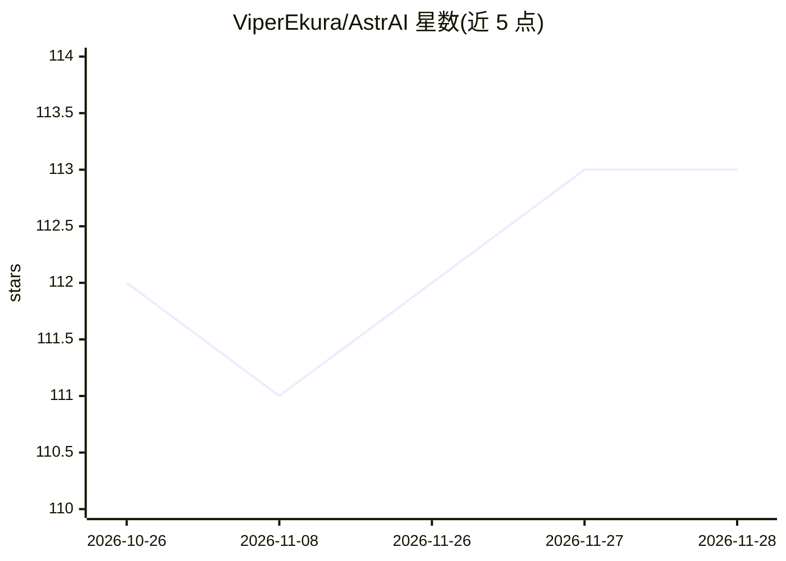

# ViperEkura/AstrAI

⭐ 113 · Python · Apache-2.0 · 推送 2026-11-26 · [GitHub](https://github.com/ViperEkura/AstrAI) · 个人维护 · 中文 README

**给开发者的轻量 Transformer 训练与推理框架**

基于 PyTorch 的 Transformer 全流程框架，覆盖数据准备（JSON/JSONL 分词、损失掩码、序列打包为二进制数据集）、预训练/SFT/DPO/在线 GRPO/PPO 训练、DDP/FSDP 等并行方案、流式推理与 HTTP 服务（OpenAI/Anthropic 风格端点），以及 MMLU/HumanEval 等评测。提供 CLI 工具与 Python 组件两种使用方式。运行要求 Python 3.12+ 与 PyTorch 2.13.0，演示需要 CUDA；Docker 部署有文档指引。许可证为 Apache-2.0。

## 筛选速览

| 维度 | 判定 | 备注 |
|---|---|---|
| AI 角色 | `ai-ecosystem` | LLM/agent 周边工具 |
| 许可风险 | `permissive` | Apache-2.0 |
| 部署形态 | `library` | 以包/库形式分发 |
| 模型依赖 | — | README 未给出锁定关系 |
| 硬件要求 | — | 无带数字的原话,不猜 |
| 安装摩擦 | `medium` | 含编译或系统依赖之一 |
| 成熟度 | — | 结构信号不足 |

## 能力要点

- 数据准备、训练、评测、推理集成于单一代码库
- 支持预训练、SFT、DPO 与在线 GRPO/PPO 目标
- 提供 OpenAI 与 Anthropic 风格的流式聊天端点
- 可选 CUDA 内核在检测到 CUDA 与 nvcc 时构建，可用 CSRC_KERNELS=false 跳过

## 适用场景

- 用自己的数据训练或微调 Transformer 模型
- 部署 checkpoint 为 HTTP 服务供应用调用
- 跨 checkpoint 对比评测（MMLU/HumanEval/困惑度等）
- 开发自定义训练目标与执行后端

## 场景标签

`模型训练` `微调` `强化学习` `推理引擎` · 领域:训练与推理

## 证据(README 行号)

> L19: AstrAI is a PyTorch framework for preparing data, training models, evaluating
> L35: |**Serving**|Expose OpenAI and Anthropic chat endpoints with streaming responses, or call the Python inference engi

## 星数曲线

2026-10-26 112 → 2026-11-28 113（+1）

---
*卡片 v1 · prompt 1.4 · 生成 2026-11-28 · 置信度 high · 依据 README sha `fe8f83042127` · [字段定义](../../DATASET.md)*
