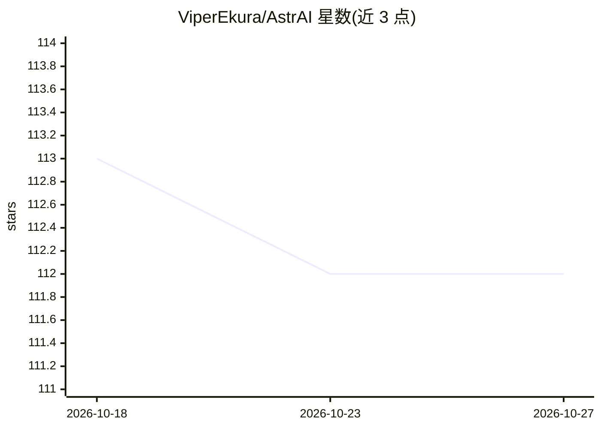

# ViperEkura/AstrAI

⭐ 112 · Python · Apache-2.0 · 推送 2026-10-26 · [GitHub](https://github.com/ViperEkura/AstrAI) · 个人维护 · 中文 README

**轻量级 Transformer 训练与推理全流程框架**

基于 PyTorch 的端到端 Transformer 框架，覆盖模型构建、预训练/SFT/DPO/GRPO/PPO 训练（DDP/FSDP 分布式）、连续批处理与 paged KV cache 推理、FastAPI 服务（OpenAI/Anthropic 兼容协议）及 MMLU/HumanEval 等评测。模型支持 GQA、MLA、MoE、RoPE。要求 Python 3.12+、锁定 PyTorch 2.13.0；训练与生成需 CUDA，CPU 支持仅限 HTTP 服务与部分评测组件。提供 git clone 源码安装与 Docker 方案。

## 筛选速览

| 维度 | 判定 | 备注 |
|---|---|---|
| AI 角色 | `ai-ecosystem` | LLM/agent 周边工具 |
| 许可风险 | `permissive` | Apache-2.0 |
| 部署形态 | `self-host` | docker 或自建部署 |
| 模型依赖 | — | README 未给出锁定关系 |
| 硬件要求 | — | 无带数字的原话,不猜 |
| 安装摩擦 | `low` | 无编译、无系统依赖或容器化 |
| 成熟度 | — | 结构信号不足 |

## 能力要点

- 预训练/SFT/DPO/在线 RL（GRPO/PPO）训练策略，支持 DDP/FSDP
- 连续批处理、paged KV cache、radix 前缀缓存的推理引擎
- FastAPI 服务提供 OpenAI 与 Anthropic 兼容 API（SSE 流式与工具调用）
- 内置融合 CUDA kernel 与注册表式扩展架构

## 适用场景

- 从零训练或微调自回归语言模型与嵌入模型
- 自建 OpenAI 兼容的推理服务端点
- 在同一框架内完成模型评测（MMLU/HumanEval/ROUGE 等）

## 场景标签

`模型训练` `微调` `强化学习` `推理引擎` · 领域:训练与推理

## 证据(README 行号)

> L25: AstrAI is an end-to-end Transformer framework for building, training, evaluating, and serving models. It provides a
> L30: |**Training**|Pre-training (`seq`), supervised fine-tuning (`sft`), DPO, and online RL (GRPO/PPO) with in-process o

## 星数曲线

2026-10-18 113 → 2026-10-27 112（-1）

---
*卡片 v1 · prompt 1.4 · 生成 2026-10-23 · 置信度 mid · 依据 README sha `c4cdae7ec35d` · [字段定义](../../DATASET.md)*
