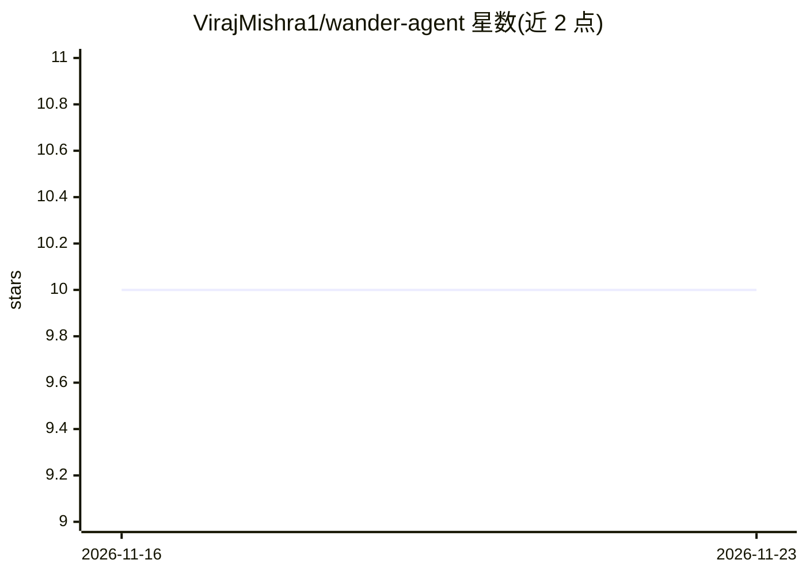

# VirajMishra1/wander-agent

⭐ 10 · Python · MIT · 推送 2026-10-04 · [GitHub](https://github.com/VirajMishra1/wander-agent) · [官网](https://pypi.org/project/wander-agent/) · 个人维护

**给 AI 助手的旅行数据 MCP 插件：实时机票/酒店/签证等查询**

一个通过 MCP 协议接入 AI 助手的旅行工具插件：为 Claude、Cursor 等 AI 客户端提供 75 个工具，覆盖机票搜索（含 hidden-city 与 split-ticket 票价）、酒店预订链接、签证规则、16 天天气预报、安全通告、预算估算、里程积分估值与行程规划。无需 API key 即可使用全部功能，可选配置 Foursquare 与 Ticketmaster key 获取餐厅评分与活动列表。以 Python 包发布，需 Python 3.10+，通过 JSON 配置文件接入各 AI 客户端。

## 筛选速览

| 维度 | 判定 | 备注 |
|---|---|---|
| AI 角色 | `ai-ecosystem` | LLM/agent 周边工具 |
| 许可风险 | `permissive` | MIT |
| 部署形态 | `self-host` | docker 或自建部署 |
| 模型依赖 | — | README 未给出锁定关系 |
| 硬件要求 | — | 无带数字的原话,不猜 |
| 安装摩擦 | `low` | 无编译、无系统依赖或容器化 |
| 成熟度 | — | 结构信号不足 |

## 能力要点

- 75 个旅行工具经 MCP 接入 Claude/Cursor 等 AI 客户端，零 API key 可用
- 机票搜索覆盖 hidden-city、split-ticket、错价票与月度最低价扫描
- 签证与护照工具：200+ 护航×中转组合、Henley 排名、双护照对比
- 积分/里程工具：每分估值、转账伙伴、积分 vs 现金决策

## 适用场景

- 让 AI 助手查询真实机票价格并规划行程
- 出行前检查签证要求与目的地安全等级
- 比较信用卡积分兑换机票的价值

## 场景标签

 · 领域:旅行/AI 工具插件

## 证据(README 行号)

> L31: Wander Agent is a **tool plugin for AI assistants** (Claude, Cursor, Windsurf, etc.) that gives the AI real travel 
> L33: Without this plugin, asking an AI "cheapest flights from New York to Tokyo in August?" gets you a made-up answer. W

## 星数曲线

2026-11-16 10 → 2026-11-23 10（+0）

---
*卡片 v1 · prompt 1.4 · 生成 2026-11-20 · 置信度 mid · 依据 README sha `6e957fde57c6` · [字段定义](../../DATASET.md)*
