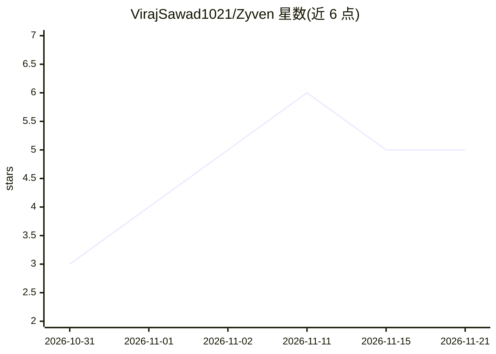

# VirajSawad1021/Zyven

⭐ 5 · Python · MIT · 推送 2026-11-20 · [GitHub](https://github.com/VirajSawad1021/Zyven) · 个人维护

**把开源库自动编译为经沙箱验证的 MCP 工具供 agent 使用**

Zyven 读取开源库源码做静态分析，用 open-weight 模型围绕该库生成 MCP server，再在无网络的 Docker 沙箱中跑六道验证门（含与直接调用库的差分比对），只有通过验证的工具才会被 agent 热加载并复用。带任务板、技能库、仓库浏览器与目录（仅限白名单 pinned 仓库）等 Web 界面，也可校验第三方 MCP server。所有结果基于 open-weight 模型；控制中心、连接与 hub 等为默认关闭的可选功能。

## 筛选速览

| 维度 | 判定 | 备注 |
|---|---|---|
| AI 角色 | `ai-ecosystem` | LLM/agent 周边工具 |
| 许可风险 | `permissive` | MIT |
| 部署形态 | `self-host` | docker 或自建部署 |
| 模型依赖 | — | README 未给出锁定关系 |
| 硬件要求 | — | 无带数字的原话,不猜 |
| 安装摩擦 | `low` | 无编译、无系统依赖或容器化 |
| 成熟度 | `idea` | |

## 能力要点

- 静态分析读取库源码，open-weight 模型生成 MCP server，写出的名字须与分析核对
- 六道验证门在无网络 Docker 沙箱运行，含与源库直接调用的差分比对
- 编译过的技能热加载并入库，复用耗时从分钟级降到秒级
- zyven verify --discover 可在信任前校验已安装的第三方 MCP server

## 适用场景

- agent 遇到精确逻辑任务（校验码、日历转换、查找）时按需获得可靠工具
- 在信任前校验已有 MCP server 的工具输出是否与源库一致
- 复用已验证技能加速同类任务的后续执行

## 场景标签

`代码生成` · 领域:编码与开发

## 证据(README 行号)

> L5: Zyven turns open-source code into verified MCP tools that an AI agent learns when it needs them, and keeps
> L36: 3. **Verify.** Six gates run in a Docker sandbox with no network. One of them compares every tool's answer with the
> L209: - **Connections.** (screenshot below) Connect any MCP server by URL or local command, or sign in through a service

## 星数曲线

2026-10-31 3 → 2026-11-21 5（+2）

---
*卡片 v1 · prompt 1.4 · 生成 2026-11-21 · 置信度 mid · 依据 README sha `c4d902c28c4b` · [字段定义](../../DATASET.md)*
