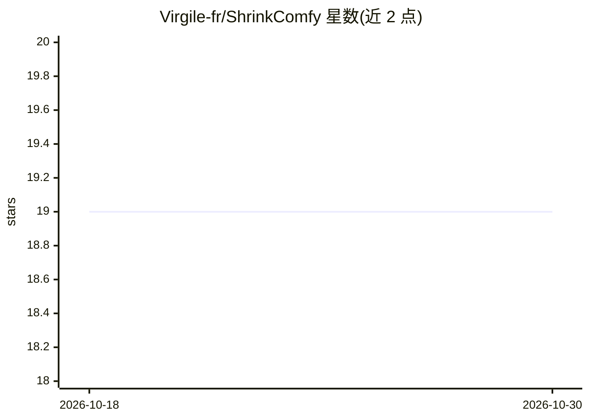

# Virgile-fr/ShrinkComfy

⭐ 19 · Python · 推送 2026-05-02 · [GitHub](https://github.com/Virgile-fr/ShrinkComfy) · 个人维护

**Windows 小工具：把 ComfyUI PNG 压缩为 WEBP/JPG 并保留工作流元数据**

面向 ComfyUI 用户的桌面图像批量转换工具：将携带 ComfyUI 工作流元数据的大体积 PNG 输出转换为更小的 WEBP 或 JPG，并把 prompt 与 workflow 元数据写回转换后文件，使拖回 ComfyUI 恢复工作流的功能可用；原 PNG 不被修改。支持文件夹扫描、大小估算、前后对比预览、按月/日归档、多 CPU worker 并行转换。限制：仅支持 PNG 输入，目前仅 Windows，需本机安装 Python 3.9+。安装方式为克隆仓库后双击 bat，首启自建虚拟环境。

## 筛选速览

| 维度 | 判定 | 备注 |
|---|---|---|
| AI 角色 | `ai-ecosystem` | LLM/agent 周边工具 |
| 许可风险 | `none` | — |
| 部署形态 | `None` |  |
| 模型依赖 | — | README 未给出锁定关系 |
| 硬件要求 | — | 无带数字的原话,不猜 |
| 安装摩擦 | `low` | 无编译、无系统依赖或容器化 |
| 成熟度 | — | 结构信号不足 |

## 能力要点

- PNG→WEBP/JPG 转换后回写 ComfyUI 工作流元数据，拖拽恢复工作流仍可用
- 转换前预览（并排/滑块对比）与输出大小、节省空间估算
- 无工作流元数据的 PNG 单独路由到 no-workflow/ 目录
- 支持保留源目录结构、按月/日归档与多 CPU worker 并行

## 适用场景

- 我有一堆 ComfyUI PNG 输出想省空间，但还想以后拖回 ComfyUI 恢复工作流
- 批量转换前先对比压缩效果、检查压缩伪影
- 整理归档转换结果并单独审阅无工作流数据的图片

## 场景标签

`图像视频处理` · 领域:感知与多模态

## 证据(README 行号)

> L5:  A small Windows app for shrinking ComfyUI PNGs to WEBP or JPG without killing the drag-and-drop workflow.
> L8: ShrinkComfy converts those PNGs to much smaller WEBP or JPG files, then puts the ComfyUI prompt and workflow metadat

## 星数曲线

2026-10-18 19 → 2026-10-30 19（+0）

---
*卡片 v1 · prompt 1.4 · 生成 2026-10-28 · 置信度 mid · 依据 README sha `8fa7723c4874` · [字段定义](../../DATASET.md)*
