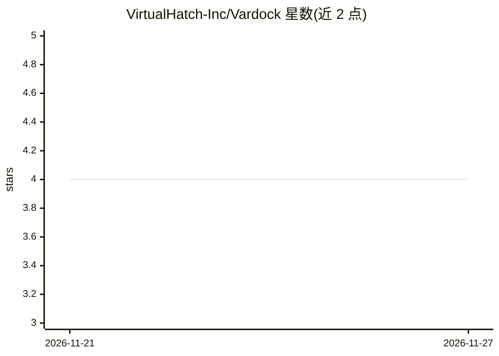

# VirtualHatch-Inc/Vardock

⭐ 4 · TypeScript · MIT · 推送 2026-11-20 · [GitHub](https://github.com/VirtualHatch-Inc/Vardock) · 组织维护

**给开发者按确定性规则运行自治 AI agent 的本地 harness**

通过对话将任务委托给后台运行的自治 agent，并用模型之外的操作权威进程按固定规则决定审批，不依赖模型自身判断。代码在隔离环境执行（macOS 用 Apple Container VM，Linux 用 Docker 容器，仅回环网络），服务令牌由权威进程保管，不进入模型输入与 worker 环境；外部请求默认等待人工确认，另有独立 witness 进程记录每个操作供事后用 `pnpm vardock verify` 核对。当前为开发者预览，仅支持源码运行、单用户，无 npm 包或桌面安装器，不支持 Windows。

## 筛选速览

| 维度 | 判定 | 备注 |
|---|---|---|
| AI 角色 | `ai-ecosystem` | LLM/agent 周边工具 |
| 许可风险 | `permissive` | MIT |
| 部署形态 | `library` | 以包/库形式分发 |
| 模型依赖 | — | README 未给出锁定关系 |
| 硬件要求 | — | 无带数字的原话,不猜 |
| 安装摩擦 | `low` | 无编译、无系统依赖或容器化 |
| 成熟度 | `idea` | |

## 能力要点

- 模型外的操作权威进程按固定规则确定性地决定审批
- agent 代码在无外网的隔离环境运行（Apple Container VM / Docker+gVisor 等）
- 独立 witness 进程记录操作并出具回执，可 pnpm vardock verify 核对
- 内置 DSH 的 Cordex 插件架构，支持 API 提供商或本地 Codex 接入模型

## 适用场景

- 在本地托管自治 agent 长时间执行任务并保持人工审批控制
- 让 agent 访问自有系统的 HTTPS/MCP 工具时保护服务令牌
- 事后审计 agent 的每次外部请求与操作记录

## 场景标签

`Agent 框架` · 领域:Agent 开发

## 证据(README 行号)

> L5:  An open-source harness for delegating work to autonomous AI agents through conversation and keeping them running en
> L18: Because it runs autonomously without assuming you are watching, Vardock does not rely on model alignment or prompt 

## 星数曲线

2026-11-21 4 → 2026-11-27 4（+0）

---
*卡片 v1 · prompt 1.4 · 生成 2026-11-21 · 置信度 mid · 依据 README sha `3f8133c47665` · [字段定义](../../DATASET.md)*
