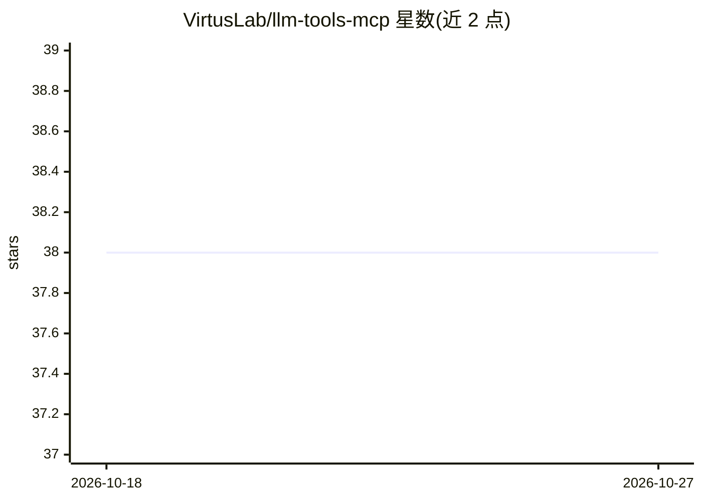

# VirtusLab/llm-tools-mcp

⭐ 38 · Python · Apache-2.0 · 推送 2025-10-31 · [GitHub](https://github.com/VirtusLab/llm-tools-mcp) · [官网](https://pypi.org/project/llm-tools-mcp/) · 组织维护

**让 llm 命令行直连 MCP 服务器的插件**

面向 simonw/llm 命令行工具的插件，使 llm 可通过 MCP（Model Context Protocol）加载外部工具：在 ~/.llm-tools-mcp 放置 mcp.json 配置服务器，再以 llm --ta -T MCP 方式调用，支持 streamable http、sse、stdio 三种传输，可动态指定自定义配置路径。README 提醒动态工具箱在 llm tools list 中不可见，stdio 连接复用与工具名冲突处理仍在待办中。以 uv 管理开发依赖，提供 docker 端到端测试脚本。

## 筛选速览

| 维度 | 判定 | 备注 |
|---|---|---|
| AI 角色 | `ai-ecosystem` | LLM/agent 周边工具 |
| 许可风险 | `permissive` | Apache-2.0 |
| 部署形态 | `library` | 以包/库形式分发 |
| 模型依赖 | — | README 未给出锁定关系 |
| 硬件要求 | — | 无带数字的原话,不猜 |
| 安装摩擦 | `low` | 无编译、无系统依赖或容器化 |
| 成熟度 | — | 结构信号不足 |

## 能力要点

- 在 shell 中通过 mcp.json 配置接入 MCP 服务器
- 支持 streamable http、sse、stdio 三种传输
- 支持动态指定自定义 MCP 配置文件路径
- 对服务器连接失败与 mcp.json 格式错误有失败处理

## 适用场景

- 在 llm 命令行里直接调用 MCP 服务器的工具（如文件系统）
- 为已有 llm 工作流扩展外部工具能力

## 场景标签

 · 领域:LLM 基础设施/工具接入

## 证据(README 行号)

> L5: **Connect to MCP servers right from your shell. Plugin for llm (by @simonw).**
> L47: 3. Run `llm` with tools.

## 星数曲线

2026-10-18 38 → 2026-10-27 38（+0）

---
*卡片 v1 · prompt 1.4 · 生成 2026-10-25 · 置信度 high · 依据 README sha `4ce9084e3ab3` · [字段定义](../../DATASET.md)*
