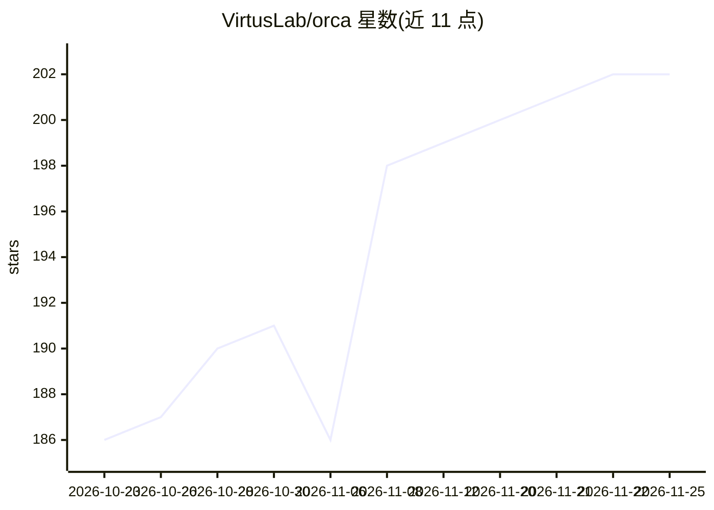

# VirtusLab/orca

⭐ 202 · Scala · Apache-2.0 · 推送 2026-11-12 · [GitHub](https://github.com/VirtusLab/orca) · [官网](https://orca.virtuslab.com) · 组织维护

**用 Scala 脚本编排 AI 编码 agent 的开发工作流工具**

面向单人开发工作流的工具：用 Scala 编写可复现的软件开发流程脚本，由 AI agent 执行编码，普通脚本处理格式化、提交、开 PR 等机械步骤；内置计划-实现-审查循环等流程，支持中断后从上次提交续跑。提供 orca CLI 与可安装到 Claude Code、Pi、OpenCode、Codex 等的 skill，可交互或无头运行；需已配置并登录 agent 后端及 gh、git。

## 筛选速览

| 维度 | 判定 | 备注 |
|---|---|---|
| AI 角色 | `ai-ecosystem` | LLM/agent 周边工具 |
| 许可风险 | `permissive` | Apache-2.0 |
| 部署形态 | `None` |  |
| 模型依赖 | — | README 未给出锁定关系 |
| 硬件要求 | — | 无带数字的原话,不猜 |
| 安装摩擦 | `low` | 无编译、无系统依赖或容器化 |
| 成熟度 | — | 结构信号不足 |

## 能力要点

- 以 Scala 脚本定义开发工作流，agent 执行编码、脚本处理提交/PR
- 内置计划-实现-审查循环等流程，可交互或无头运行
- 流程可中断续跑：每阶段完成即提交，重跑从上次提交继续
- 以 skill 形式安装进 Claude Code / Pi / OpenCode / Codex，供编码 agent 委托调用

## 适用场景

- 让 agent 写的代码强制经过另一个 agent 审查后再合入
- 把格式化、提交、开 PR 等步骤从 agent 中剥离为脚本执行
- 单开发者的 AI 辅助开发流程编排与任务分解

## 场景标签

`编码 Agent` `工作流自动化` · 领域:效率与自动化

## 证据(README 行号)

> L5: Orca allows you to programmatically define software development workflows where
> L11: Orca comes with an `orca` cli and a skill, which can be used interactively by
> L27: Orca assumes that it has configured, logged-in access to Claude, Codex,

## 星数曲线

2026-10-23 186 → 2026-11-25 202（+16）

---
*卡片 v1 · prompt 1.4 · 生成 2026-11-25 · 置信度 high · 依据 README sha `a372868677de` · [字段定义](../../DATASET.md)*
