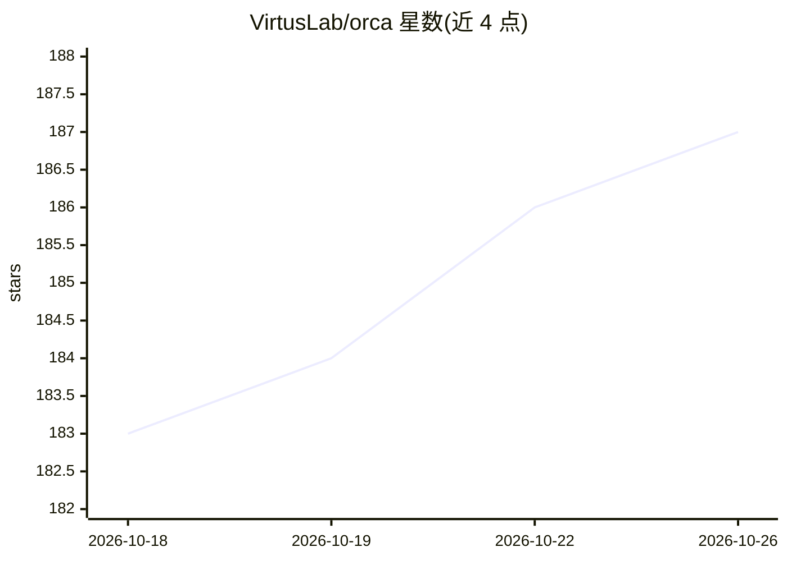

# VirtusLab/orca

⭐ 187 · Scala · Apache-2.0 · 推送 2026-10-22 · [GitHub](https://github.com/VirtusLab/orca) · [官网](https://orca.virtuslab.com) · 组织维护

**用 Scala 脚本定义确定性 AI 编码工作流的开源工具**

面向单人开发者工作流的 AI 驱动软件开发编排工具：以 Scala 脚本（scala-cli 运行，无需其他依赖）定义软件开发流程，由 AI agent 执行编码，脚本处理格式化、提交、创建 PR 等确定性步骤。内置 plan-implement-review 等流程，各阶段提交后可从断点恢复。需配置 Claude、Codex、OpenCode、Pi 或 Gemini 之一及 gh、git。提供 orca CLI 与可供 agent 调用的 skill，需在沙箱环境运行。

## 筛选速览

| 维度 | 判定 | 备注 |
|---|---|---|
| AI 角色 | `ai-ecosystem` | LLM/agent 周边工具 |
| 许可风险 | `permissive` | Apache-2.0 |
| 部署形态 | `None` |  |
| 模型依赖 | — | README 未给出锁定关系 |
| 硬件要求 | — | 无带数字的原话,不猜 |
| 安装摩擦 | `low` | 无编译、无系统依赖或容器化 |
| 成熟度 | — | 结构信号不足 |

## 能力要点

- Scala 脚本定义开发工作流，scala-cli 单命令运行，自动引导依赖
- 流程可恢复：中断后从最后一次提交继续
- 内置 plan-implement-review 循环等流程，可交互或无头运行
- 提供或可作为 skill 被 Claude Code、Pi、OpenCode 等 agent 调用

## 适用场景

- 我希望 AI 生成的代码总是被另一个 agent 审查，并把该要求写成代码
- 让编码 agent 把规划、实现、审查、开 PR 的流程自动化跑完
- 用普通脚本承担提交、格式化等非编码步骤以节省 token

## 场景标签

`编码 Agent` `工作流自动化` · 领域:效率与自动化

## 证据(README 行号)

> L5: Orca allows you to programmatically define software development workflows where
> L27: Orca assumes that it has configured, logged-in access to Claude, Codex,

## 星数曲线

2026-10-18 183 → 2026-10-26 187（+4）

---
*卡片 v1 · prompt 1.4 · 生成 2026-10-22 · 置信度 high · 依据 README sha `6d3837ac2171` · [字段定义](../../DATASET.md)*
