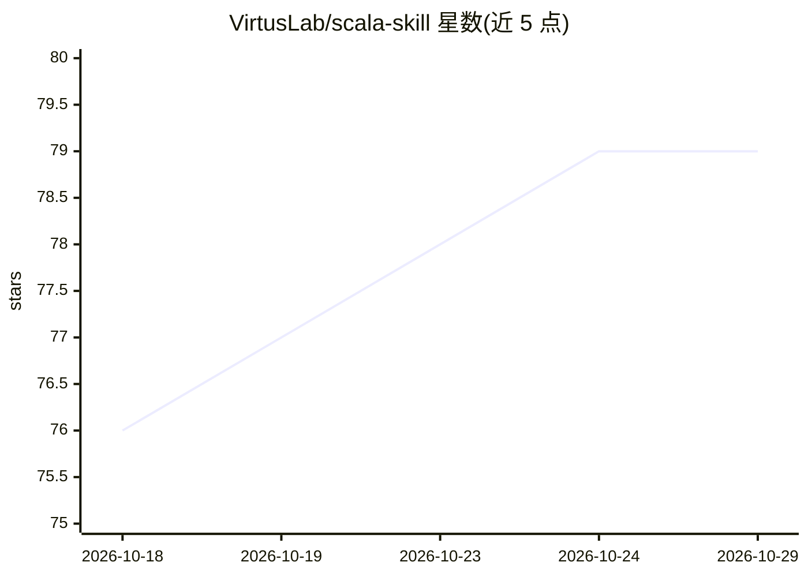

# VirtusLab/scala-skill

⭐ 79 · 推送 2026-10-16 · [GitHub](https://github.com/VirtusLab/scala-skill) · 组织维护

**面向 Claude Code/Codex 等 Agent 的 Scala 编码技能包**

由 VirtusLab 维护的 Scala 技能集合，以 SKILL.md 格式提供给编码 Agent 使用，当前包含 direct-style-scala 一项：覆盖 Scala 编码风格、工具链、函数式编程指导，并含 direct-style Scala、Ox 结构化并发与同步 Tapir 专节。通过 Claude Code 插件市场、Codex 插件市场安装，Cursor/OpenCode/Pi 亦可从 ~/.agents/skills/ 目录直接发现；手动安装为快照式拷贝，不自动更新，README 给出符号链接加 git pull 的更新方式。

## 筛选速览

| 维度 | 判定 | 备注 |
|---|---|---|
| AI 角色 | `ai-knowledge` | 知识聚合/清单类 |
| 许可风险 | `none` | — |
| 部署形态 | `None` |  |
| 模型依赖 | — | README 未给出锁定关系 |
| 硬件要求 | — | 无带数字的原话,不猜 |
| 安装摩擦 | `low` | 无编译、无系统依赖或容器化 |
| 成熟度 | — | 结构信号不足 |

## 能力要点

- direct-style-scala 技能：Scala 风格、工具链与函数式编程指导
- 含 Ox 结构化并发与同步 Tapir 专节
- 支持 Claude Code 插件市场、Codex 插件市场与 Cursor/OpenCode/Pi 的 SKILL.md 目录发现
- 提供符号链接方案实现多编辑器统一更新

## 适用场景

- 让 Claude Code / Codex 在写 Scala 时遵循 direct-style 风格与工具链约定
- 在 Cursor、OpenCode、Pi 中通过 SKILL.md 复用同一份 Scala 技能
- 团队把技能提交到项目仓库统一编码规范

## 场景标签

`提示工程` · 领域:Agent 开发

## 证据(README 行号)

> L3: A collection of Scala skills for [Claude
> L9: - **direct-style-scala** —
> L64: These editors load Agent Skills (the `SKILL.md`

## 星数曲线

2026-10-18 76 → 2026-10-29 79（+3）

---
*卡片 v1 · prompt 1.4 · 生成 2026-10-24 · 置信度 high · 依据 README sha `77de098096f9` · [字段定义](../../DATASET.md)*
