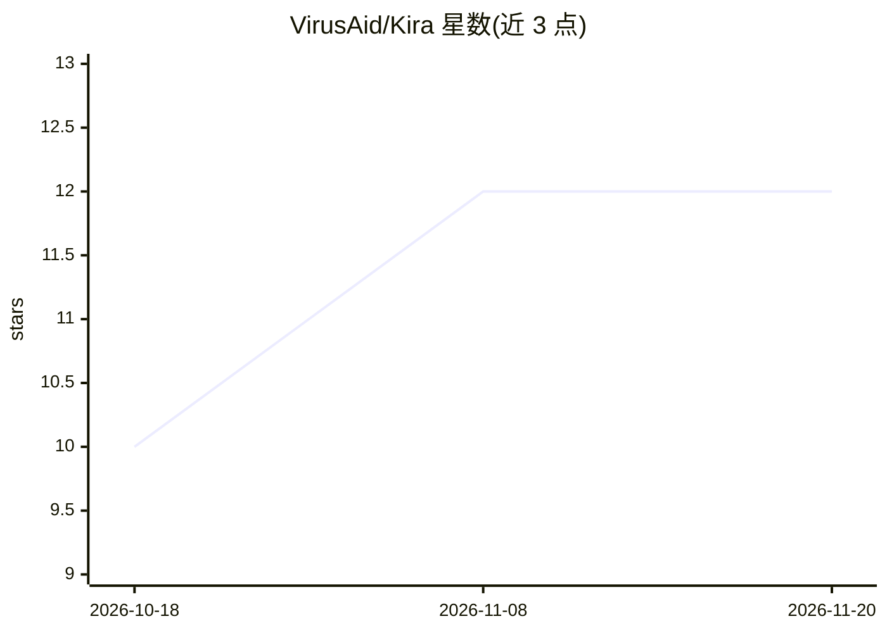

# VirusAid/Kira

⭐ 12 · TypeScript · NOASSERTION · 推送 2026-08-08 · [GitHub](https://github.com/VirusAid/Kira) · 个人维护

**Windows 个人语音 AI 助手：本地运行、语音与屏幕交互、控制 PC**

面向 Windows 10/11 用户的桌面个人 AI 助手：支持语音唤醒与识别（Silero/Vosk 离线）、屏幕视觉感知、本地文档语义检索、记忆与技能学习；80 余条命令本地即时执行，复杂任务调用本地或云端 LLM。默认本地 Qwen3（经 Ollama）运行，可选 Groq/OpenRouter/Gemini/DeepSeek/Claude/GLM 等云端提供方。Electron+React 构建，提供 Windows 安装包与源码构建命令。许可证为专有，仅限个人非商业使用。

## 筛选速览

| 维度 | 判定 | 备注 |
|---|---|---|
| AI 角色 | `ai-native` | 本体是模型或模型工具 |
| 许可风险 | `none` | NOASSERTION |
| 部署形态 | `library` | 以包/库形式分发 |
| 模型依赖 | local-ok | 支持本地模型 |
| 硬件要求 | — | 无带数字的原话,不猜 |
| 安装摩擦 | `low` | 无编译、无系统依赖或容器化 |
| 成熟度 | — | 结构信号不足 |

## 能力要点

- 离线语音识别与 Silero 神经语音合成，本地命令无需联网
- 屏幕实时视觉感知与本地文档语义索引（PDF/Word/笔记）
- 短语→动作的本地学习机制，二次确认后离线自动执行
- 支持 MCP 扩展（stdio 与 Streamable HTTP），自身亦可作 MCP 服务器

## 适用场景

- 用语音打开程序、查天气、设提醒、整理下载目录
- 在本地文档知识库中按语义提问而不上传文件
- 通过 Obsidian/Notion/Google 日历/Gmail/Telegram 集成处理日常事务

## 场景标签

`AI 助手` `语音 Agent` `语音识别` `语音合成` · 领域:对话与助手

## 证据(README 行号)

> L5: ### Твой личный ИИ-помощник для Windows
> L125: **Кира думает и разговаривает локально — без ключей и без интернета.**
> L148: Kira — **не обёртка над ChatGPT**, а самостоятельная платформа. Философия

## 星数曲线

2026-10-18 10 → 2026-11-20 12（+2）

---
*卡片 v1 · prompt 1.4 · 生成 2026-11-18 · 置信度 high · 依据 README sha `e27d582b51d4` · [字段定义](../../DATASET.md)*
