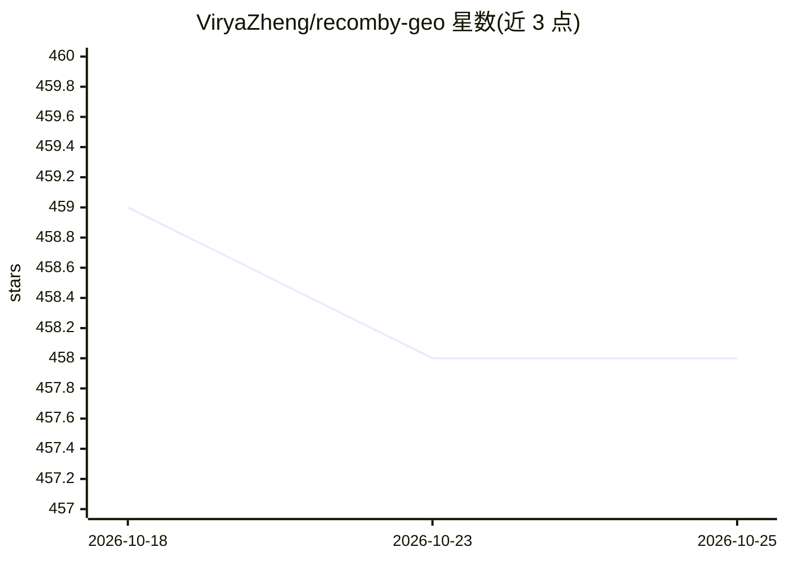

# ViryaZheng/recomby-geo

⭐ 458 · Python · MIT · 推送 2026-07-04 · [GitHub](https://github.com/ViryaZheng/recomby-geo) · 组织维护 · 中文 README

**GEO（生成引擎优化）领域 AI 员工方案：skills 与生态清单**

面向需要 GEO/SEO 内容优化团队的开源方案：核心是 plugins/recomby-geo/ 下的 6 个 GEO 专业知识 skill（SEO 优化、内容生产、质量审计、内链、关键词、Meta 标签）与 7 阶段协作工作流命令（/01-intake 到 /07-reaudit），安装到支持 skill/plugin 的 agent CLI（以 Claude Code 为主要示例）中，由模型按 description 自动调用。另附 agents.md 与 clis.md 两份方案架构说明页，汇集可加载 skills 的 agent 与国内外办公软件 CLI。方案定位 Local-first，agent 可接 Ollama/vLLM 等本地模型，业务数据不出本地。自述 alpha 阶段。

## 筛选速览

| 维度 | 判定 | 备注 |
|---|---|---|
| AI 角色 | `ai-knowledge` | 知识聚合/清单类 |
| 许可风险 | `permissive` | MIT |
| 部署形态 | `None` |  |
| 模型依赖 | — | README 未给出锁定关系 |
| 硬件要求 | — | 无带数字的原话,不猜 |
| 安装摩擦 | `low` | 无编译、无系统依赖或容器化 |
| 成熟度 | `idea` | |

## 能力要点

- 6 个 GEO 专业 skill + 7 个自研工作流命令，模型按 description 自动匹配调用
- 工作流含硬约束：brief 未达 ready-for-production 时 /05-production 拒绝生成
- 各阶段输出经 JSON Schema 校验后进入下一阶段
- 附 agent 与办公 CLI 两份生态清单，方案声明 Local-first、零 API Key

## 适用场景

- 给 Claude Code 等 agent 安装 GEO 优化技能做内容协作
- 业务专家与 agent 按 7 阶段工作流协作产出 GEO 内容
- 敏感数据场景下用本地模型跑 GEO 工作流

## 场景标签

`AI 写作` `精选清单` `提示工程` · 领域:Agent 开发

## 证据(README 行号)

> L25: |**GEO Skills**|**本项目自研 + vendor 开源**|✓ 主战场 → `plugins/recomby-geo/skills/`|
> L27: 我们做三件事：**集合主流 Agent CLI、集合国内外办公软件 CLI、封装 GEO 专业知识 skills**。
> L35: `agents.md` 和 `clis.md` 不是产品的另一部分——它们是**方案架构说明页**：讲清楚我们的 GEO skills 在「业务专家 + Agent + 办公 CLI + Skills」这套 AI 员工方案里处于什

## 星数曲线

2026-10-18 459 → 2026-10-25 458（-1）

---
*卡片 v1 · prompt 1.4 · 生成 2026-10-21 · 置信度 high · 依据 README sha `864e4763d989` · [字段定义](../../DATASET.md)*
