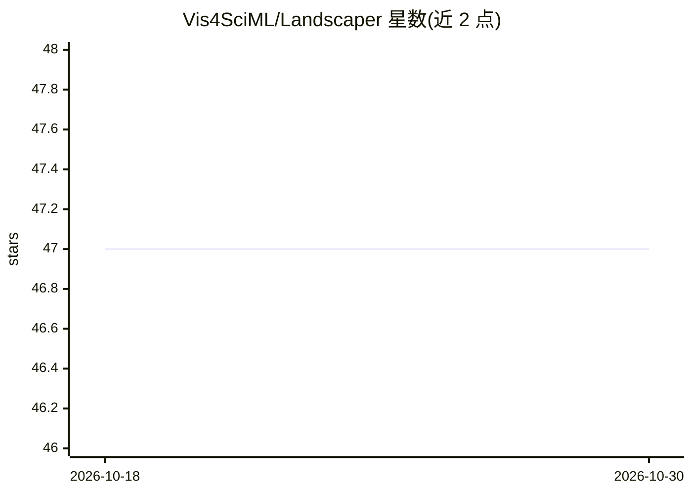

# Vis4SciML/Landscaper

⭐ 47 · Python · NOASSERTION · 推送 2026-10-12 · [GitHub](https://github.com/Vis4SciML/Landscaper) · [官网](https://vis4sciml.github.io/Landscaper/) · 组织维护

**深度学习模型损失景观的构建、量化与可视化 Python 框架**

面向深度学习研究者的损失景观分析框架：通过低维与高维采样构建损失景观表示（含改编自 PyHessian 的 Hessian 分析），应用包括基于拓扑数据分析（TDA）的平滑度指标在内的量化指标，并提供可视化工具。支持 Python >=3.10,<3.13 与 PyTorch >=2.0.0，兼容 CPU 与 GPU 环境。通过 PyPI 提供 pip 安装，另有基于官方 PyTorch 镜像的 Docker 镜像，文档含安装、使用与示例。由伯克利实验室、UC Berkeley 与亚利桑那州立大学联合持有版权。

## 筛选速览

| 维度 | 判定 | 备注 |
|---|---|---|
| AI 角色 | `ai-ecosystem` | LLM/agent 周边工具 |
| 许可风险 | `none` | NOASSERTION |
| 部署形态 | `self-host` | docker 或自建部署 |
| 模型依赖 | — | README 未给出锁定关系 |
| 硬件要求 | — | 无带数字的原话,不猜 |
| 安装摩擦 | `low` | 无编译、无系统依赖或容器化 |
| 成熟度 | — | 结构信号不足 |

## 能力要点

- 低维/高维采样构建损失景观，含 Hessian 分析
- 基于拓扑数据分析（TDA）的平滑度量化指标
- 损失景观可视化工具
- 提供 Docker 镜像（基于官方 PyTorch 镜像）

## 适用场景

- 分析我训练的深度学习模型的损失景观形态
- 用 TDA 平滑度指标量化模型行为
- 可视化损失景观用于研究与论文图表

## 场景标签

`科研工具` · 领域:学习与行业

## 证据(README 行号)

> L6: `Landscaper` is a comprehensive Python framework designed for exploring the loss landscapes of deep learning models.
> L8: - **Construction**: Builds detailed loss landscape representations through low and high-dimensional sampling, includ
> L9: - **Quantification**: Applies advanced metrics, including a novel topological data analysis (TDA) based smoothness m
> L10: - **Visualization**: Offers intuitive tools to visualize and interpret loss landscapes, providing actionable insigh

## 星数曲线

2026-10-18 47 → 2026-10-30 47（+0）

---
*卡片 v1 · prompt 1.4 · 生成 2026-10-25 · 置信度 high · 依据 README sha `8b9067f7a01f` · [字段定义](../../DATASET.md)*
