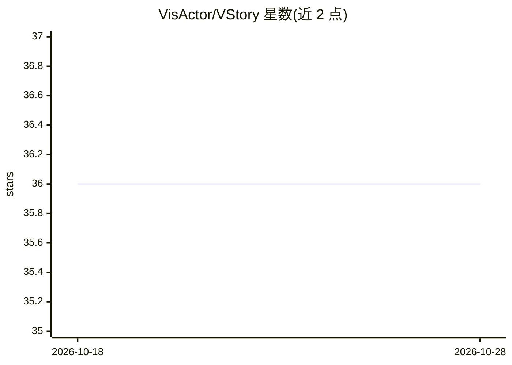

# VisActor/VStory

⭐ 36 · TypeScript · MIT · 推送 2026-04-13 · [GitHub](https://github.com/VisActor/VStory) · [官网](https://www.visactor.io/vstory) · 组织维护 · 中文 README

**面向开发者的数据叙事可视化开发框架（编辑器+组件）**

VisActor 体系下的叙事可视化开发框架，基于 VChart 图表库、VGrammar 可视化语法库与 VRender 渲染引擎封装组件，提供标注、动画、流程控制与叙事模板等叙事增强能力，自动适配桌面、H5 与多种小程序环境。仓库含 vstory 核心编辑器包与中英文文档站点源码；开发需全局安装 @microsoft/rush 后克隆源码构建。README 标注为 intelligent data narrative 框架，LLM 为其主题标签之一。

## 筛选速览

| 维度 | 判定 | 备注 |
|---|---|---|
| AI 角色 | `ai-enhanced` | 去掉 AI 部分产品仍成立 |
| 许可风险 | `permissive` | MIT |
| 部署形态 | `library` | 以包/库形式分发 |
| 模型依赖 | — | README 未给出锁定关系 |
| 硬件要求 | — | 无带数字的原话,不猜 |
| 安装摩擦 | `low` | 无编译、无系统依赖或容器化 |
| 成熟度 | — | 结构信号不足 |

## 能力要点

- 基于 VChart/VGrammar/VRender 封装的叙事组件
- 标注、动画、流程控制与叙事模板能力
- 跨平台适配桌面、H5 与多种小程序环境

## 适用场景

- 开发数据大屏、信息图、数据视频等叙事可视化场景
- 构建带动画与标注的叙事可视化编辑器
- 查看中英文文档与示例进行二次开发

## 场景标签

 · 领域:数据可视化

## 证据(README 行号)

> L10: VStory, tell stories with data. An intelligent data narrative development framework.
> L18: VStory is a narrative visualization development framework in the VisActor visualization system. It encapsulates com

## 星数曲线

2026-10-18 36 → 2026-10-28 36（+0）

---
*卡片 v1 · prompt 1.4 · 生成 2026-10-25 · 置信度 mid · 依据 README sha `f1b1c744ee4e` · [字段定义](../../DATASET.md)*
