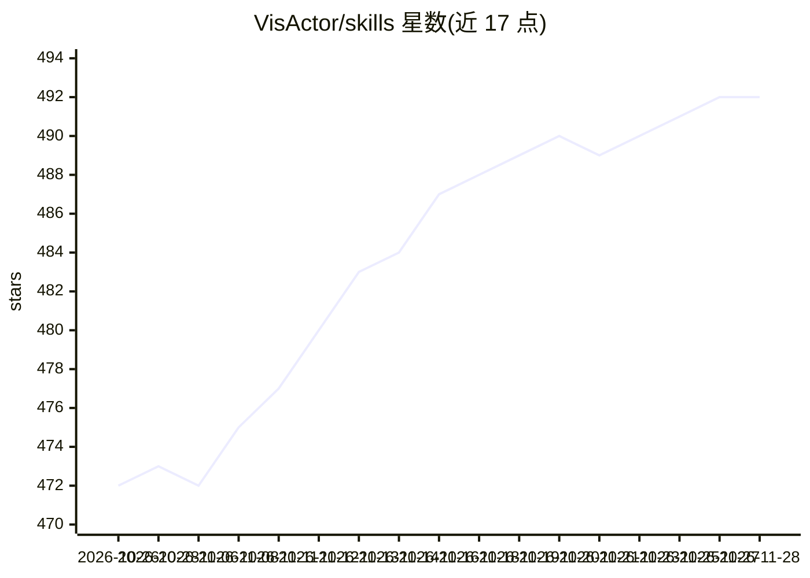

# VisActor/skills

⭐ 492 · HTML · MIT · 推送 2026-11-20 · [GitHub](https://github.com/VisActor/skills) · [官网](https://www.visactor.com/skills) · 组织维护 · 中文 README

**为支持 Skills 的 Agent 提供图表、数据故事与海报工具集**

VisActor Skills 为 Claude Code、Codex、WorkBuddy、豆包工作等支持 Skills 协议的 Agent 提供可安装的技能包，覆盖商务图表、图表叙事、交互式数据故事、杂志式图文、传记海报、业务/地图仪表盘与自助图表编辑等任务。每个 Skill 以 SKILL.md、参考文件与脚本组成的独立目录发布，可通过 npx skills add 命令行安装，或经 GitHub Releases 下载 ZIP 手动导入；各 Skill 有各自的 Python/Node/浏览器运行时要求。图表与表格技能维护在 VChart/VTable 各自仓库中单独安装。

## 筛选速览

| 维度 | 判定 | 备注 |
|---|---|---|
| AI 角色 | `ai-knowledge` | 知识聚合/清单类 |
| 许可风险 | `permissive` | MIT |
| 部署形态 | `library` | 以包/库形式分发 |
| 模型依赖 | — | README 未给出锁定关系 |
| 硬件要求 | — | 无带数字的原话,不猜 |
| 安装摩擦 | `low` | 无编译、无系统依赖或容器化 |
| 成熟度 | — | 结构信号不足 |

## 能力要点

- 11 个独立可安装 Skill，覆盖图表、数据故事、海报与仪表盘任务
- 支持 npx skills add 命令行安装与 ZIP 手动导入两种途径
- 每个 Skill 自含 SKILL.md、模板资源与脚本，并有确定性回归测试
- VChart/VTable 技能从各自库仓库直接安装

## 适用场景

- 让 Agent 把 CSV 数据生成可分享的 HTML 数据故事或 Web-PPT
- 把文章与素材转成杂志风格的 HTML/PNG 系列图文
- 从有出处的事件与照片生成带时间线的传记海报
- 搭建含指标、筛选和地图的业务仪表盘

## 场景标签

`数据分析` `图像生成` · 领域:效率与自动化

## 证据(README 行号)

> L5: VisActor Skills provides chart, dashboard, data story and poster tools for Claude Code, Codex, WorkBuddy, Doubao Wor
> L9: ## Skills
> L34: Each Skill can be installed separately and includes its instructions, references and scripts. The agent provides mo

## 星数曲线

2026-10-26 472 → 2026-11-28 492（+20）

---
*卡片 v1 · prompt 1.4 · 生成 2026-11-25 · 置信度 mid · 依据 README sha `16175a7b5d55` · [字段定义](../../DATASET.md)*
