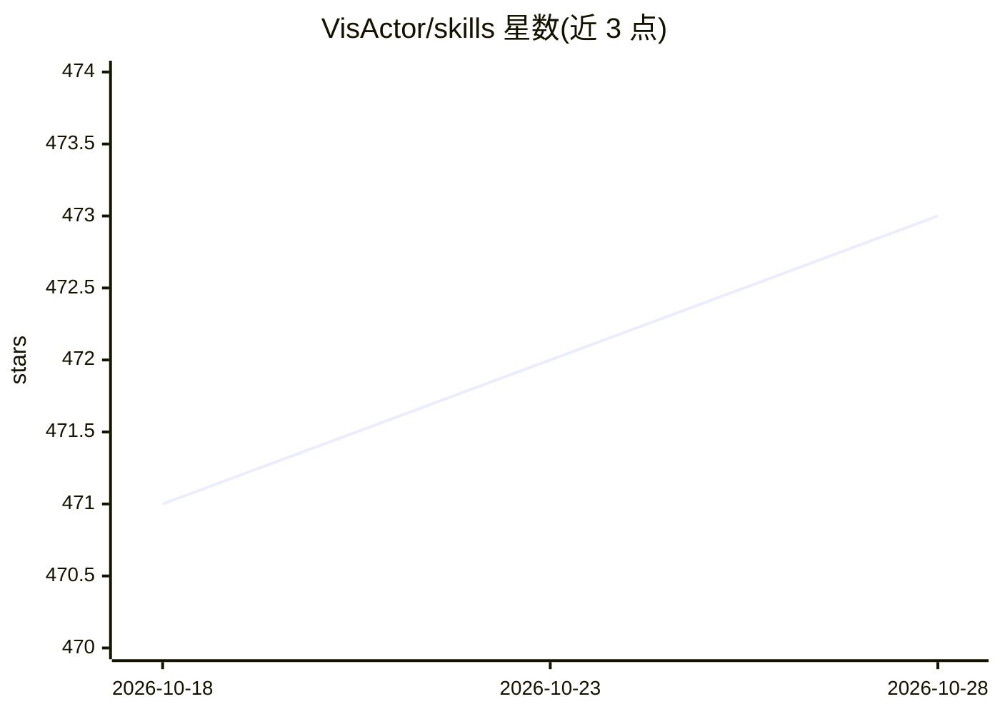

# VisActor/skills

⭐ 473 · HTML · MIT · 推送 2026-10-26 · [GitHub](https://github.com/VisActor/skills) · [官网](https://www.visactor.io/vmind) · 组织维护 · 中文 README

**为宿主 Agent 提供数据故事、杂志图文与生平海报生成技能**

面向 Codex/Claude Code 等宿主 Agent 的技能集，用 npx skills add 安装 chart-storytelling、editorial-magazine、life-chronicle；每个技能含 SKILL.md、参考、模板与脚本，模型与工具执行由宿主提供，无需 VisActor CLI、MCP 服务或模型 key。可输出 HTML 数据故事、Web-PPT、杂志图文与生平海报；VChart/VTable 技能另行维护在对应仓库。

## 筛选速览

| 维度 | 判定 | 备注 |
|---|---|---|
| AI 角色 | `ai-native` | 本体是模型或模型工具 |
| 许可风险 | `permissive` | MIT |
| 部署形态 | `library` | 以包/库形式分发 |
| 模型依赖 | — | README 未给出锁定关系 |
| 硬件要求 | — | 无带数字的原话,不猜 |
| 安装摩擦 | `low` | 无编译、无系统依赖或容器化 |
| 成熟度 | — | 结构信号不足 |

## 能力要点

- 本仓库维护 chart-storytelling、editorial-magazine、life-chronicle 三个技能
- 每个技能包含 SKILL.md、参考、模板与脚本，可独立安装
- 无需 VisActor CLI、MCP server、模型 key 或托管 VisActor API；宿主 Agent 提供模型
- 输出 HTML 故事/Web-PPT、HTML/PNG 杂志系列与带可编辑时间线的生平海报

## 适用场景

- 让我的 Agent 把 CSV 数据解释成可分享的 HTML 数据故事或 Web-PPT
- 把文章和来源资料转成可编辑的 HTML/PNG 杂志图文系列
- 用照片与事件资料生成带可编辑时间线的生平海报

## 场景标签

`数据分析` `图像生成` · 领域:效率与自动化

## 证据(README 行号)

> L5: Agent skills for the VisActor visualization ecosystem. Create data stories, editorial image series and biography pos
> L26: Each skill includes its instructions, local references, templates and scripts. No separate VisActor CLI, MCP server
> L28: **Recommended: use the Skills directly in Codex or Claude Code.** Your agent provides model access and tool executi

## 星数曲线

2026-10-18 471 → 2026-10-28 473（+2）

---
*卡片 v1 · prompt 1.4 · 生成 2026-10-22 · 置信度 mid · 依据 README sha `b223143026b9` · [字段定义](../../DATASET.md)*
