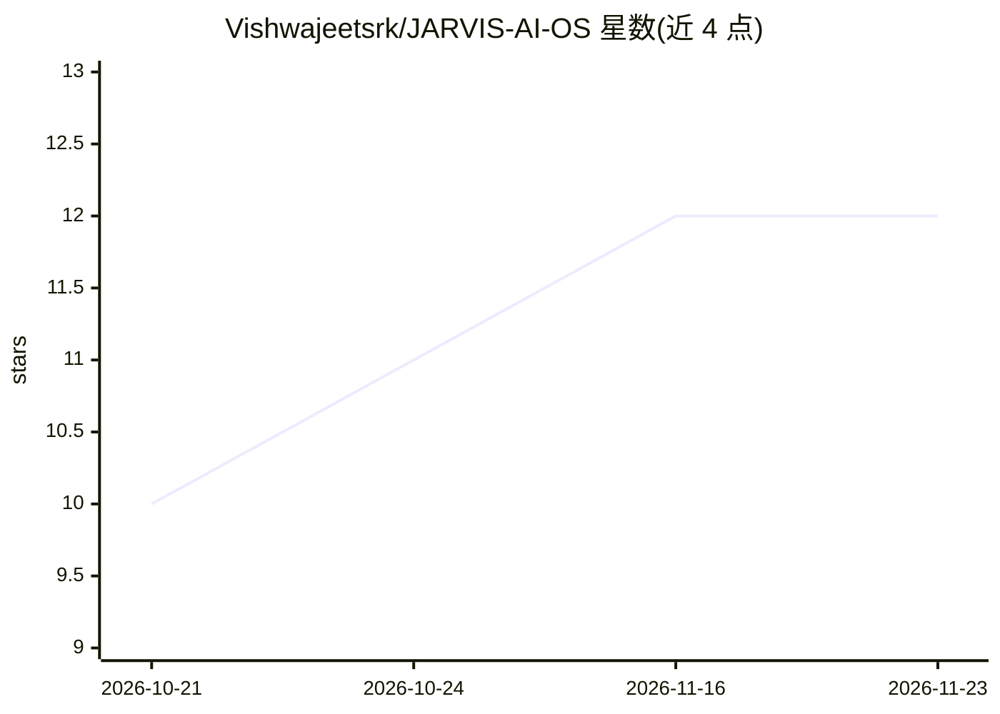

# Vishwajeetsrk/JARVIS-AI-OS

⭐ 12 · HTML · MIT · 推送 2026-09-01 · [GitHub](https://github.com/Vishwajeetsrk/JARVIS-AI-OS) · [官网](https://jarvisaios.vercel.app) · 个人维护

**面向工程师/创作者的自主 AI OS：18 个专家 Agent 协作平台**

基于 Next.js 15 + React 19 + Three.js + Supabase 的个人 AI 工作台，包含 3D 粒子界面、18 个专职 Agent（开发、运维、销售、财务等）、多模型回退路由链（Gemini/Claude/GPT-4o/Groq/本地 Ollama）。功能模块覆盖 ATS 简历生成、内容视频脚本创作、自由职业客户发现与 CRM、Windows 本地设备桥接与沙箱控制台。破坏性操作与邮件发送需人工确认门控，MIT 许可，需 Node 18+ 与各模型 API key 本地部署运行。

## 筛选速览

| 维度 | 判定 | 备注 |
|---|---|---|
| AI 角色 | `ai-native` | 本体是模型或模型工具 |
| 许可风险 | `permissive` | MIT |
| 部署形态 | `library` | 以包/库形式分发 |
| 模型依赖 | local-ok | 支持本地模型 |
| 硬件要求 | — | 无带数字的原话,不猜 |
| 安装摩擦 | `low` | 无编译、无系统依赖或容器化 |
| 成熟度 | — | 结构信号不足 |

## 能力要点

- 18 个专职 AI Agent（Chief of Staff、Developer、DevOps、Salesforce CRM 等）
- 多模型回退路由：Gemini 2.5 Flash / Claude 3.7 / GPT-4o / Groq / 本地 Ollama
- ATS 简历生成器：JD 关键词提取注入、Google XYZ 公式优化、多格式导出
- Windows PC Device Bridge：本地应用启动器与沙箱 PowerShell 控制台

## 适用场景

- 一站式生成并编辑目标岗位的 ATS 简历
- 用多个专职 Agent 管理开发、销售与内容创作流程
- 自由职业者发现客户机会并生成个性化提案
- 通过桌面桥接在浏览器中操作本地 Windows 工作区

## 场景标签

`多智能体` `AI 助手` · 领域:Agent 开发

## 证据(README 行号)

> L40: - **18 Specialized AI Personas**: Dedicated agents for **Chief of Staff**, **Developer**, **Engineering Architect**
> L41: - **Multi-Model Fallback Chain**: Intelligent prompt routing across **Google Gemini 2.5 Flash**, **Anthropic Claude
> L45: - **⚡ AI Role Resume Generator**: Instantly synthesizes 100/100 ATS resumes for any target job role or pasted Job D

## 星数曲线

2026-10-21 10 → 2026-11-23 12（+2）

---
*卡片 v1 · prompt 1.4 · 生成 2026-11-18 · 置信度 mid · 依据 README sha `963fb5774528` · [字段定义](../../DATASET.md)*
