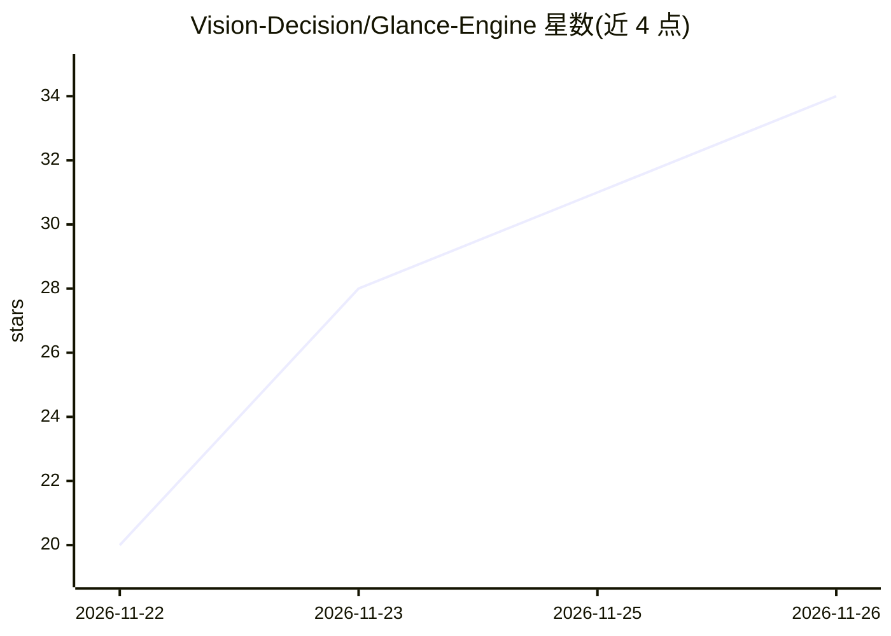

# Vision-Decision/Glance-Engine

⭐ 34 · Python · Apache-2.0 · 推送 2026-11-21 · [GitHub](https://github.com/Vision-Decision/Glance-Engine) · 组织维护

**视觉决策模型推理引擎：一次前向回答多问题、一问扫描多图**

Glance Engine 是面向视觉决策模型的服务引擎：读取一张图像后，用 readout heads 在单次前向中输出全部问题的类型化答案（box、yes/no、选项概率），无需逐 token 生成文本；另一模式将同一问题在数百张缓存图像构成的 bank 上扫描。机制包括每批一次打包变长 prefill、Gated DeltaNet 内核从共享状态延续问题分支、图像前缀字节上限缓存。CPU 上可运行测试套件，真实权重在 CUDA 上以 BF16 运行；v1 引擎仅在一类 GPU 上调优测量。

## 筛选速览

| 维度 | 判定 | 备注 |
|---|---|---|
| AI 角色 | `ai-native` | 本体是模型或模型工具 |
| 许可风险 | `permissive` | Apache-2.0 |
| 部署形态 | `library` | 以包/库形式分发 |
| 模型依赖 | — | README 未给出锁定关系 |
| 硬件要求 | `cpu-ok` | |
| 安装摩擦 | `medium` | 含编译或系统依赖之一 |
| 成熟度 | — | 结构信号不足 |

## 能力要点

- 一次前向输出 32 个类型化答案，readout heads 替代文本生成
- 一个问题扫描数百张缓存图像，前缀 bank 复用
- conformal 校准的 not-in-any 判定，误报率有界
- HTTP 服务器（glance-serve）与 Python API 两种使用方式

## 适用场景

- 对一张图像批量提出多个定位/判断问题并低延迟取回答案
- 在大量缓存图像上检索满足同一描述的目标
- 自托管 HTTP 服务处理图像决策请求

## 场景标签

`推理引擎` · 领域:训练与推理

## 证据(README 行号)

> L3: **Ask a vision model 32 questions about an image and get 32 typed answers in 49 ms.** Glance Engine serves decision
> L4: models: it reads an image once, answers every question in one forward pass with readout heads instead of generated
> L183: - Serves Glance and Glance-X models. The v1 engine is tuned and measured on one GPU class (RTX PRO 6000, SM120), a

## 星数曲线

2026-11-22 20 → 2026-11-26 34（+14）

---
*卡片 v1 · prompt 1.4 · 生成 2026-11-22 · 置信度 mid · 依据 README sha `8d5c319fd1f6` · [字段定义](../../DATASET.md)*
