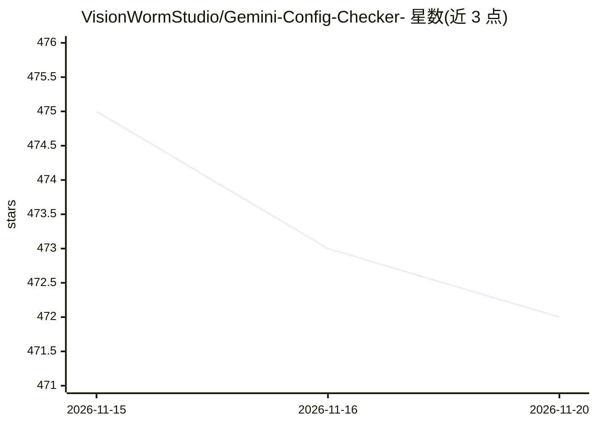

# VisionWormStudio/Gemini-Config-Checker-

⭐ 472 · Go · Apache-2.0 · 推送 2026-11-15 · [GitHub](https://github.com/VisionWormStudio/Gemini-Config-Checker-) · 个人维护

**扫描代理配置能否真正进入 Google AI Studio 与 Gemini 的桌面/移动工具**

代理配置链路检测器：以已登录浏览器的真实访问路径逐个测试 vless/vmess/trojan/ss 等配置能否通过 Google 的区域封锁（读取 AI Studio/Gemini 的拦截页面作为判定），并提供 connectivity-only 快速模式。Simple 模式测试自有配置，Advanced 模式将免费配置链在一个可用 base 配置之后寻找可接受的出口；内置可编辑的 anti-DPI 分片配置（PattN 配方）与本地分片转发器，内嵌 Xray-core，基于 Wails 构建桌面端。提供 Windows/macOS/Linux 桌面与 Web 服务端、Android APK（仅连通性模式）。区域检测需 Chrome/Edge/Brave 浏览器并登录 Google 账号；macOS/Linux/Android 构建尚未在真机验证。

## 筛选速览

| 维度 | 判定 | 备注 |
|---|---|---|
| AI 角色 | `ai-enhanced` | 去掉 AI 部分产品仍成立 |
| 许可风险 | `permissive` | Apache-2.0 |
| 部署形态 | `desktop` | 安装包/桌面程序 |
| 模型依赖 | — | README 未给出锁定关系 |
| 硬件要求 | — | 无带数字的原话,不猜 |
| 安装摩擦 | `medium` | 含编译或系统依赖之一 |
| 成熟度 | `idea` | |

## 能力要点

- 以已登录浏览器读取 Google 区域封锁页面作为判定信号（非 HTTP 探测）
- Simple/Advanced 双模式，Advanced 支持免费配置链在 base 配置之后测试
- 可编辑的 anti-DPI 分片配置（Finalmask/ALPN/密码套件）与本地分片转发器
- Windows/macOS/Linux 桌面、Web 服务端与 Android APK 多形态分发

## 适用场景

- 检测手头一堆代理配置里哪些能真正打开 AI Studio 和 Gemini
- Cloudflare 配置可连但出口被 Google 拦时，用链式配置寻找其他出口
- 在过滤网络中启用 anti-DPI 配置后验证连通性
- 导出可用的单条或链式 Xray 配置用于日常使用

## 场景标签

`浏览器自动化` · 领域:效率与自动化

## 证据(README 行号)

> L11: Find proxy configs that actually get you into **Google AI Studio and Gemini**, by testing each one the way a person
> L136: Inside Iran, plain Cloudflare configs mostly connect only with the settings below

## 星数曲线

2026-11-15 475 → 2026-11-20 472（-3）

---
*卡片 v1 · prompt 1.4 · 生成 2026-11-17 · 置信度 mid · 依据 README sha `846e83cebb20` · [字段定义](../../DATASET.md)*
