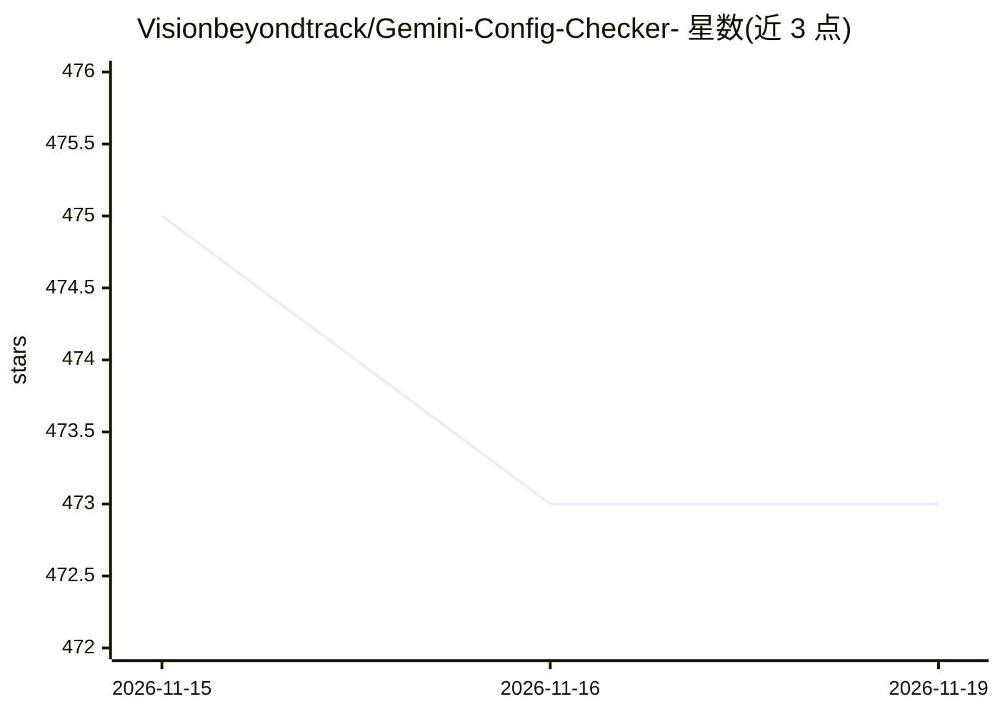

# Visionbeyondtrack/Gemini-Config-Checker-

⭐ 473 · Makefile · Apache-2.0 · 推送 2026-11-15 · [GitHub](https://github.com/Visionbeyondtrack/Gemini-Config-Checker-) · 个人维护

**扫描代理配置能否真正进入 Google AI Studio 与 Gemini 的桌面/移动工具**

代理配置链路检测工具：以已登录浏览器的真实访问方式逐条测试 vless/vmess/trojan/ss 等配置，读取 Google 对 AI Studio 与 Gemini 的区域判定；Advanced 模式可将免费配置链在一个可用基础配置后测试不同出口。内嵌 Xray-core 引擎，提供 anti-DPI 分片配置（Finalmask/ALPN/密码套件）。以 Wails 桌面应用（Windows/macOS/Linux）、Android APK 与 Web 服务三种形态分发；版本 0.1.0 早期预发布，仅 Windows 经过实际运行验证。

## 筛选速览

| 维度 | 判定 | 备注 |
|---|---|---|
| AI 角色 | `ai-enhanced` | 去掉 AI 部分产品仍成立 |
| 许可风险 | `permissive` | Apache-2.0 |
| 部署形态 | `desktop` | 安装包/桌面程序 |
| 模型依赖 | — | README 未给出锁定关系 |
| 硬件要求 | — | 无带数字的原话,不猜 |
| 安装摩擦 | `medium` | 含编译或系统依赖之一 |
| 成熟度 | `idea` | |

## 能力要点

- 以已登录浏览器读取 Google 对 AI Studio/Gemini 的区域判定（区别于仅连通性探测）
- Simple/Advanced 双模式，Advanced 支持基础配置+免费配置的链式测试与链式导出
- 内嵌 Xray-core，复现 PattN 分片 anti-DPI 配方（Finalmask、13 套密码套件等）
- 提供 Windows/macOS/Linux 桌面应用、Android APK 与 Web 服务构建

## 适用场景

- 测试手头一批代理配置哪些能进入 AI Studio 和 Gemini
- 基础配置能连但被 Google 区域封锁时，寻找可用的链式出口
- 受 DPI 过滤网络内验证带 anti-DPI 配置的连通性

## 场景标签

`浏览器自动化` · 领域:效率与自动化

## 证据(README 行号)

> L11: Find proxy configs that actually get you into **Google AI Studio and Gemini**, by testing each one the way a person
> L50: Google decides region availability **per signed-in account, after the page has loaded**. A plain HTTP request (even

## 星数曲线

2026-11-15 475 → 2026-11-19 473（-2）

---
*卡片 v1 · prompt 1.4 · 生成 2026-11-17 · 置信度 high · 依据 README sha `846e83cebb20` · [字段定义](../../DATASET.md)*
