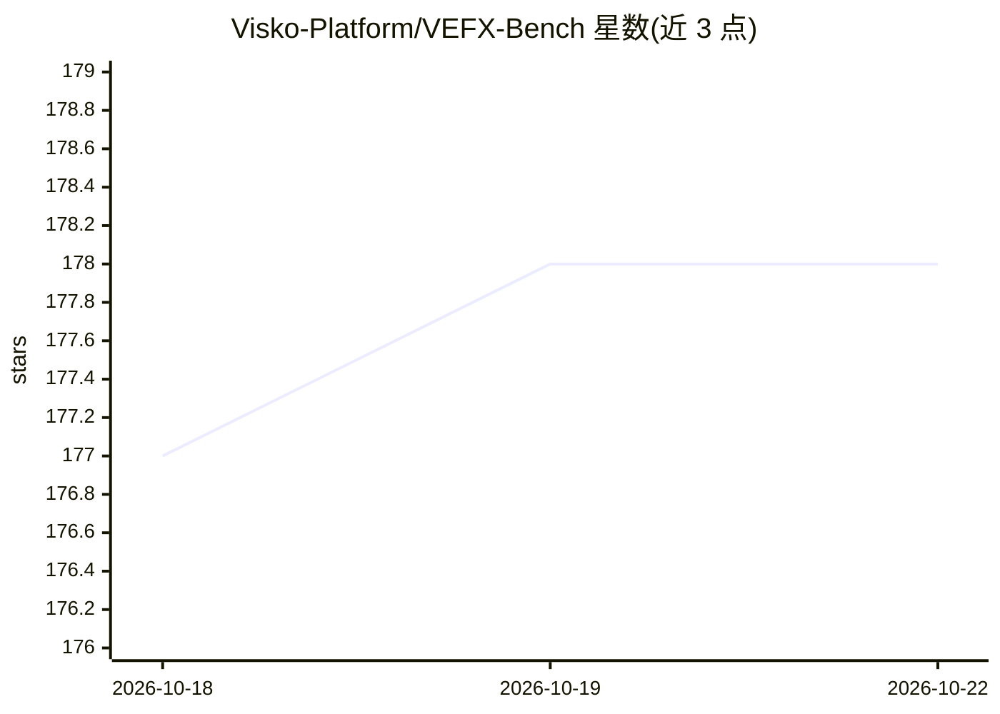

# Visko-Platform/VEFX-Bench

⭐ 177 · Python · Apache-2.0 · 推送 2026-05-16 · [GitHub](https://github.com/Visko-Platform/VEFX-Bench) · [官网](https://xiangbogaobarry.github.io/VEFX-Bench/) · 组织维护

**视频编辑与视觉特效评测基准及 VLM 奖励模型**

面向文本驱动视频编辑与视觉特效的评测基准：包含 5,049 条标注样例、9 大类 32 子类、300 组测试对，覆盖属性修改、物体移除、风格迁移、镜头运动等任务。核心组件 VEFX-Reward 是基于 Qwen3-VL 的奖励模型（4B/32B），从指令遵循、渲染质量、编辑排他性三个维度按 1–4 分打分，提供 Python API、CLI、批量与多 GPU 评分脚本，并维护公开模型排行榜。运行需 Python≥3.10 与 CUDA GPU。

## 筛选速览

| 维度 | 判定 | 备注 |
|---|---|---|
| AI 角色 | `ai-ecosystem` | LLM/agent 周边工具 |
| 许可风险 | `permissive` | Apache-2.0 |
| 部署形态 | `None` |  |
| 模型依赖 | — | README 未给出锁定关系 |
| 硬件要求 | `gpu-24g` | |
| 安装摩擦 | `medium` | 含编译或系统依赖之一 |
| 成熟度 | — | 结构信号不足 |

## 能力要点

- 5,049 条标注样例，9 类 32 子类任务组织
- VEFX-Reward（4B/32B）按 IF/RQ/EE 三维 1–4 分评分
- 支持批量 CSV 评分与多 GPU 评分脚本
- 维护 10 个编辑系统的公开排行榜

## 适用场景

- 视频编辑模型开发者评测与对比模型效果
- 用奖励模型为编辑结果自动打分
- 查阅排行榜了解各编辑系统的能力分布

## 场景标签

`模型评测` · 领域:评测与运维

## 证据(README 行号)

> L17: **VEFX-Bench** is a comprehensive benchmark for evaluating text-driven video editing and visual effects. It include
> L66: |**VEFX-Reward-4B**|Qwen3-VL-4B-Instruct|4B|xiangbog/VEFX-Reward-4B|✅ Available|

## 星数曲线

2026-10-18 177 → 2026-10-22 178（+1）

---
*卡片 v1 · prompt 1.4 · 生成 2026-10-22 · 置信度 high · 依据 README sha `d4ccea8067d6` · [字段定义](../../DATASET.md)*
