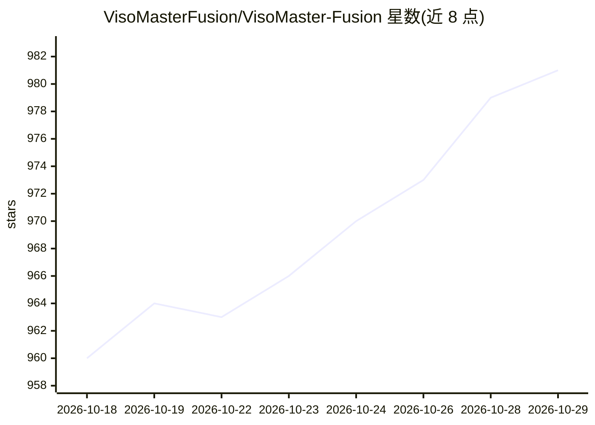

# VisoMasterFusion/VisoMaster-Fusion

⭐ 981 · Python · GPL-3.0 · 推送 2026-10-24 · [GitHub](https://github.com/VisoMasterFusion/VisoMaster-Fusion) · 组织维护

**桌面端 AI 换脸与视频编辑软件（图像/视频/摄像头）**

面向桌面用户的 AI 换脸、人脸增强与编辑应用，支持图像、视频与摄像头实时流。提供多种换脸模型（Inswapper128、SimSwap、GhostFace、CSCS、DFM 等）、多人脸工作流、遮罩/修复/增强管线、批处理 Job Manager、时间线标记与多段渲染，另含 VR180 支持。推理后端为 CUDA、TensorRT（默认）或 CPU。仅支持 Windows 10/11 64 位，推荐 Nvidia GPU（6GB VRAM 起步，8-12GB 更佳）；多数用户通过便携启动器安装，首次运行需联网下载约 20-30GB 依赖与模型。README 附带伦理使用声明，要求获得当事人同意。

## 筛选速览

| 维度 | 判定 | 备注 |
|---|---|---|
| AI 角色 | `ai-native` | 本体是模型或模型工具 |
| 许可风险 | `viral` | GPL-3.0 |
| 部署形态 | `desktop` | 安装包/桌面程序 |
| 模型依赖 | — | README 未给出锁定关系 |
| 硬件要求 | `gpu-8g` | |
| 安装摩擦 | `medium` | 含编译或系统依赖之一 |
| 成熟度 | — | 结构信号不足 |

## 能力要点

- 多种换脸模型与多人脸工作流（含 ByteTrack 跟踪）
- 图像/视频/摄像头/虚拟相机及 VR180 工作流
- CUDA/TensorRT/CPU 推理后端，TensorRT 为默认
- 便携启动器自动安装 Python 3.12、FFmpeg、PyTorch、TensorRT 与模型

## 适用场景

- 给视频或图片替换指定人脸并做细节修复
- 摄像头实时换脸输出到虚拟相机
- 批量无人值守处理多任务作业
- 制作影视特效与 VR180 内容

## 场景标签

`图像视频处理` · 领域:感知与多模态

## 证据(README 行号)

> L3: VisoMaster Fusion is a desktop application for AI-powered face swapping, enhancement, and editing on images, videos,
> L35: - Multiple swapper models, including Inswapper128, InStyleSwapper variants, SimSwap, GhostFace, CSCS, and DeepFaceL

## 星数曲线

2026-10-18 960 → 2026-10-29 981（+21）

---
*卡片 v1 · prompt 1.4 · 生成 2026-10-21 · 置信度 mid · 依据 README sha `cf15441f1cce` · [字段定义](../../DATASET.md)*
