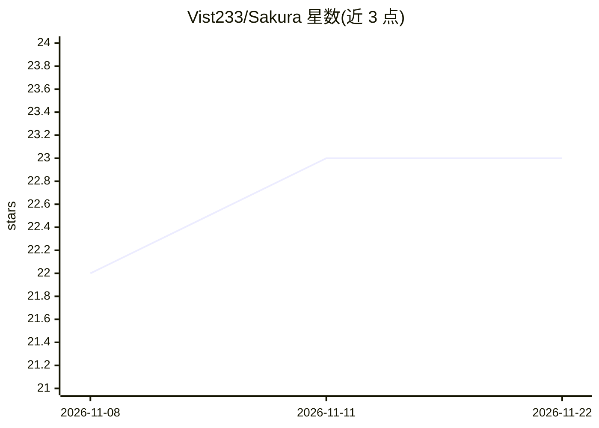

# Vist233/Sakura

⭐ 23 · TypeScript · MIT · 推送 2026-11-18 · [GitHub](https://github.com/Vist233/Sakura) · [官网](https://sakura.zhangyvjing.com) · 个人维护 · 中文 README

**用 TypeScript 代码构建 Codex 风格编码 agent 的库**

以库形式提供完整编码 agent 循环（工具、会话、压缩、目标、审查、子 agent），通过 createAgent 一行代码创建默认 agent，含 read/write/edit/bash 工具与 AGENTS.md 指令加载。面向要在自己代码中定义 agent 或运行 agent 集群的开发者。核心机制：无状态内核 + 8 个钩子 + 3 个接口，JSONL 树状会话文件支持崩溃后续跑/分叉/回退；review/redaction 安全插件默认关闭且失败即拦截；不自带沙箱，confine 仅约束文件工具。模型接入任意 Chat Completions 端点（README 称试过 DeepSeek、Kimi、OpenCode Go）。

## 筛选速览

| 维度 | 判定 | 备注 |
|---|---|---|
| AI 角色 | `ai-ecosystem` | LLM/agent 周边工具 |
| 许可风险 | `permissive` | MIT |
| 部署形态 | `library` | 以包/库形式分发 |
| 模型依赖 | — | README 未给出锁定关系 |
| 硬件要求 | — | 无带数字的原话,不猜 |
| 安装摩擦 | `low` | 无编译、无系统依赖或容器化 |
| 成熟度 | — | 结构信号不足 |

## 能力要点

- createAgent 一行创建含默认工具集的完整编码 agent
- JSONL 会话文件支持 resume、fork、rewind，崩溃后同一文件继续运行
- review/redaction 安全插件 opt-in 且 fail closed
- 支持 SSH 远程环境、agent 集群（Promise.all）、MCP 客户端与子 agent

## 适用场景

- 在自己的产品中嵌入执行特定任务的编码 agent
- 批量运行多个各有分工的 agent（文档、测试、审查并行）
- 构建带审查与密钥脱敏的无人值守长时运行 agent

## 场景标签

`Agent 框架` `编码 Agent` · 领域:Agent 开发

## 证据(README 行号)

> L5: **Sakura is the Codex-style coding agent as a library.** The whole loop (tools, sessions, compaction, goals, review,
> L60: |What it is|a terminal agent product; `exec --json` for automation; can run as an MCP server|a "minimal, extensible
> L100: - **What it is:** a library for TypeScript code, plus a minimal CLI (`sakura run`, `sakura resume`) and, in the re

## 星数曲线

2026-11-08 22 → 2026-11-22 23（+1）

---
*卡片 v1 · prompt 1.4 · 生成 2026-11-18 · 置信度 high · 依据 README sha `39d0ed0554f7` · [字段定义](../../DATASET.md)*
