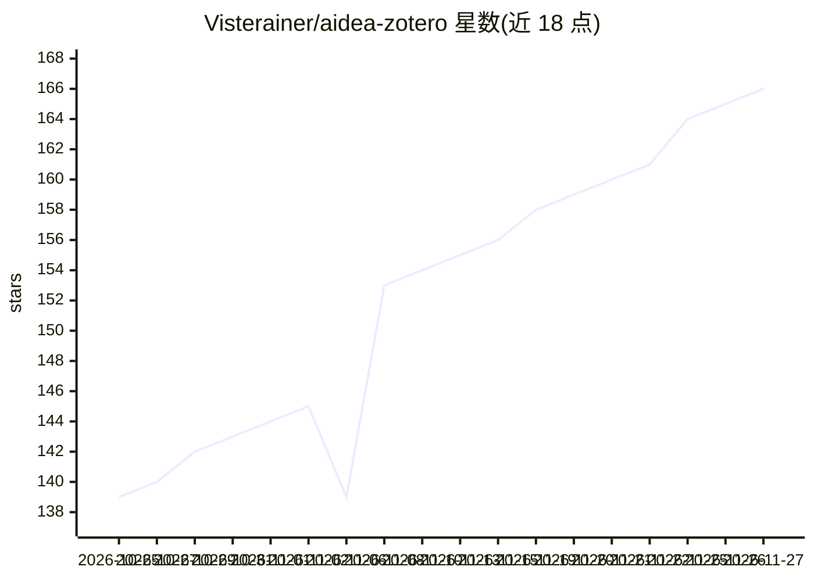

# Visterainer/aidea-zotero

⭐ 166 · TypeScript · AGPL-3.0 · 推送 2026-11-25 · [GitHub](https://github.com/Visterainer/aidea-zotero) · [官网](https://visterainer.github.io/aidea-zotero/) · 个人维护 · 中文 README

**Zotero 论文问答与双语 PDF 翻译的开源插件**

面向 Zotero 7–10 的免费开源阅读助手插件：对 PDF/EPUB 中的段落提问，回答带定位引用，可跳转到对应 PDF 页或 EPUB 章节，并能保存为 Zotero 笔记；支持划词翻译、批量生成单语/双语 PDF（含 OCR 方向校正）、对话导出导入、通讯作者档案生成。接入 ChatGPT 与 GitHub Copilot 账号（OAuth）、OpenAI 兼容 API 及本地模型；历史与记忆本地存储；界面支持 13 种语言。AGPL-3.0-or-later 许可，基于 llm-for-zotero 项目。

## 筛选速览

| 维度 | 判定 | 备注 |
|---|---|---|
| AI 角色 | `ai-native` | 本体是模型或模型工具 |
| 许可风险 | `viral` | AGPL-3.0 |
| 部署形态 | `None` |  |
| 模型依赖 | local-ok | 支持本地模型 |
| 硬件要求 | — | 无带数字的原话,不猜 |
| 安装摩擦 | `low` | 无编译、无系统依赖或容器化 |
| 成熟度 | — | 结构信号不足 |

## 能力要点

- 回答附定位引用，可跳转 PDF 页或 EPUB 章节
- 划词翻译并保存为笔记或高亮批注
- 批量双语 PDF 翻译，队列可断点续传
- 支持 ChatGPT/GitHub Copilot OAuth、OpenAI 兼容 API 与本地模型

## 适用场景

- 阅读论文时对公式或图表提问并保留解释为笔记
- 批量生成中英对照的双语 PDF 供精读
- 将整库论文问答对话导出迁移到另一设备
- 为多篇论文生成通讯作者档案笔记

## 场景标签

`文档问答` · 领域:知识与检索

## 证据(README 行号)

> L19: **AIdea is a free, open-source reading assistant for Zotero 7–10.** Ask about a passage in a PDF or EPUB, follow a 
> L65: AIdea supports ChatGPT and GitHub Copilot accounts, OpenAI-compatible APIs, and local models served by tools such a

## 星数曲线

2026-10-25 139 → 2026-11-27 166（+27）

---
*卡片 v1 · prompt 1.4 · 生成 2026-11-27 · 置信度 high · 依据 README sha `649521eba0eb` · [字段定义](../../DATASET.md)*
